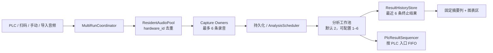

# 多运行常驻音频测试 Core 设计

日期：2026-07-25

状态：已批准；2026-07-27 MVP amendment 为最新权威

## 1. 文档定位

本文是“常驻音频流、多运行并发测试和多结果显示”改造的总纲规格。
它定义跨子系统不可违背的产品行为、架构边界、数据身份、并发上限、故障语义和验收标准。

MVP 的解释和验收必须先应用 18.1。18.1 是本文最新权威；与它冲突的早期正文、2026-07-26
amendment、19.6 跨进程/耐久权威门禁及其测试均被覆盖，只作为 Phase 2 设计资产保留。18.1 明确保留的
UI、Resident 和 Scheduler 安全要求继续有效，已经完成或正在执行的对应 leaf task 不因本次收敛失效。

后续必须拆分为以下五份职责子规格。各子规格的 semantic 文档可按依赖并行编写和审查；编号表示
职责清单，不表示文档必须串行完成。只依赖单一已审 child contract、且不导入或修改跨 child 接口和
shared wiring 的 leaf implementation，可在该 child spec/plan PASS 后独立执行 TDD、规格符合性审查
和代码质量审查；已经按该规则完成或正在执行的 UI leaf task 不因本修订失效。所有跨 child adapter、
production cutover、容器/controller/`main_window`/shared integration 仍需各自经审规格和计划，
但 MVP 不再等待 19.6 的 Phase 2 integration resume manifest。每个 child plan 可以设置比 Core
更严格且不改变产品含义的本地 gate：

1. 常驻音频采集池、时间戳环形缓冲与六路并发录音；
2. 多 `run_id` 运行协调、分析队列与 PLC FIFO；
3. 本地运行、音频和分析尝试记录，以及唯一不覆盖的音频路径；
4. 结果历史、固定摘要列、锁定模式与可选实时预览；
5. 本地硬件管理保护、重启生效规则和端到端集成验收。

子规格可以补充实现细节，但不得降低或改变本文定义的保证。若子规格发现本文存在冲突或缺口，
必须先修订并重新审查本文，不能在实现中自行选择另一种语义。

本文不是单个实现任务，也不授权一次性重写全部相关模块。

## 2. 背景与当前行为

当前工厂模式面向单运行设计：

- `FactoryModeController` 在 `running`、`analyzing` 和 `reanalyzing` 阶段阻止新的启动；
- PLC 和扫码信号在忙碌阶段会被记录后丢弃，PLC 启动位随后被自动复位，信号不可恢复；
- 控制器只持有一个活动配置、一个活动运行和一个 `FactoryReviewPayload`；
- `TestManager` 的多个运行与完成会话仍有按 `config_id` 索引的路径，同一配置的新运行可能覆盖旧上下文；
- 结果模块和所有图表监听同一个当前结果，界面只能展示一条结果；
- 录音器虽然已经支持同一设备的多个 capture owner，但输入流仍随测试创建和停止；
- 启动路径包含设备枚举、输入格式检查、线程启动、PortAudio 流打开和首块等待；
- 每次 capture 还会额外丢弃约 50 ms 的预热采样；
- 普通 PLC 默认轮询间隔约为 200 ms；
- 当前结果面板是一个可配置且纵向滚动的网格，其中 `result_summary` 仍是网格项目。

因此，前一台设备结束录音并进入计算时，下一台设备的信号不会开始新的测试；即使仅移除控制器的
忙碌判断，单例运行身份、单例结果载荷、按配置索引和 PLC 回写也会产生覆盖或串线。

## 3. 目标

1. 支持最多六条受管输入硬件记录和任意数量的测试配置。
2. 受管输入硬件最多六条；启动时为全部精确解析成功的受管硬件维持最多六条常驻输入流。
3. 最多同时录制六条运行；录音结束立即释放录音名额。
4. 分析与录音解耦，前一条正在等待分析或分析时仍可开始下一条录音。
5. 同一个测试配置允许在上一条录音或分析尚未结束时再次触发。
6. 每次触发都使用独立 `run_id` 隔离状态、音频、分析、结果、停止、重分析和 PLC 顺序。
7. 以程序接收到 PLC、扫码或手动启动事件的时间作为录音起点，不再因创建流或预热主动丢失起始音频。
8. 将普通 PLC 默认轮询间隔降为 50 ms，并允许现场配置到 20 ms。
9. 分析使用独立工作池，默认并发两条，可配置为一至六条。
10. 结果摘要改为固定独立列，展示活动运行和最近六条终止结果。
11. 提供锁定自动跟随、解锁手动选择、按运行查看图表和可选的单运行实时预览。
12. 一条硬件流、一次保存或一次分析的故障不能污染或覆盖其他运行。
13. 不在原位置删除、覆盖或改名现有测试配置、硬件配置、校准数据、数据库记录和录音文件；
    开发期 v2 的可执行准入与历史投影按第 18 节的权威修订处理。

## 4. 非目标与已接受限制

- 软件不负责保证隔音箱内不同待测设备之间的声学互不干扰。
- 不支持超过六条同时录音，也不支持超过六条受管实际输入硬件记录。
- 测试配置总数不受限制；受管输入硬件记录最多六条。
- 不把分析任务计入六条录音名额。
- 不把界面最近六条结果缓存持久化到下次程序启动。
- 不迁移旧结果面板布局，不保留旧 `result_summary` 网格项目。
- 不增加 PLC `run_id`、结果序号或新的结果消费确认字段。
- 软件只保证同一 `plc_id` 的 PLC 结果写入调用按该 PLC 的入口顺序发生，不保证 PLC 已经消费上一条结果。
  在相同结果地址上，后续结果可能覆盖前一条；这是用户明确接受的现场协议限制。
- 不在锁定模式中让活动任务抢占最新完成结果的图表。
- 不同时显示多条活动运行的实时图表。
- 不要求实时预览显示每一个中间帧；显示帧可降频或丢弃，但原始录音和最终分析不得受影响。
- 不引入独立音频采集进程。
- 不进行与本功能无关的 DSP、数据库或界面重构。

## 5. 术语

- **实际硬件**：由硬件管理功能保存，并以稳定 `hardware_id` 标识的输入设备记录。
- **常驻流**：应用启动时为有效受管输入硬件打开、并保持到有界关闭的 PortAudio 输入流。
- **运行**：一次触发产生的独立测试尝试，无论最后成功、失败、被拒绝或被停止。
- **活动运行**：已接受且处于录音中、等待保存、等待分析或分析中的初始运行。
- **终止结果**：成功、NG、无结果、错误、容量拒绝或手动停止的运行结果。
- **重新分析操作**：依附于一条仍在结果缓存中的终止结果的二次分析；它不创建新运行或新卡片，
  也不计入 active capture；hardware mutation 门禁只按全局 active capture 是否为零裁决。
- **配置快照**：触发被接受时冻结的测试配置、硬件解析信息和校准数据。
- **锁定模式**：右侧结果自动跟随最新终止结果，旧结果卡不可选择的显示模式。
- **实时预览**：解锁后选择一张活动卡时，对该运行低优先级、可降频的临时图表显示。

## 6. 方案选择

### 6.1 采用：常驻采集池 + 多运行协调器

采用一个按 `hardware_id` 去重的常驻音频采集池、一套按 `run_id` 管理的运行协调器、
独立分析调度器、结果历史存储和 PLC 结果排序器。

该方案复用现有应用进程、Qt 服务结构和分析能力，同时消除每次启动时重新打开输入流的延迟。

### 6.2 不采用：每个配置预建完整会话

该方案会让引用同一硬件的配置重复占用资源，并使“配置数量不限”与预建资源数量直接冲突。

### 6.3 不采用：独立音频采集进程

独立进程能提供更强故障隔离，但需要额外的 IPC、共享内存、时钟映射和恢复协议，超出当前需求。

## 7. 总体架构

### 7.1 ResidentAudioPool

负责：

- 启动时解析全部有效受管输入硬件行并固定本进程 stream set；
- 同一实际硬件只创建一条输入流；
- 维护流格式、健康状态、时间戳映射和至少 2.0 秒环形缓冲；
- 注册和移除多个并发 capture owner；
- 原子拥有全局六条 capture lease，提供预留、提交、释放和取消；
- 将音频块可靠送入每条活动 capture；
- 发布流可用、失败和输入溢出事件；MVP 不在当前进程自动恢复失败流；
- 在启动、`RESTART_REQUIRED` 收束和程序退出时协调流生命周期。

它不负责测试配置判定、结果排序、PLC 写入或界面选择。

### 7.2 MultiRunCoordinator

负责：

- 在事件入口第一时间记录单调时钟时间；
- 路由配置并执行启动前校验；
- 为每次尝试分配唯一 `run_id`；
- 冻结配置与校准快照；
- 管理按 `run_id` 索引的运行状态机；
- 通过 `ResidentAudioPool` 的 capture lease 接口申请录音名额，不维护第二份容量计数；
- 把完成录音交给持久化和分析调度；
- 把终止结果交给结果历史和 PLC 排序器；
- 按 `run_id` 处理停止、迟到事件和重新分析。

它不直接执行 PortAudio 回调、重型 DSP 或图表绘制。

### 7.3 AnalysisScheduler

负责：

- 使用独立工作池执行最终分析和重新分析；
- 默认同时分析两条，允许配置为一至六条；
- 全局 pending queue 使用启动时冻结的 `pending_capacity`，默认 64；配置必须是非 `bool` 正整数，
  该值是当前进程的 exact hard bound，不包含正在 worker 中执行的任务；
- `pending_capacity` 非法时 scheduler 不 ready，新的 run/reanalysis admission 保持关闭并显示配置错误；
- initial、imported 和 reanalysis 共用 `pending_capacity`，提交必须立即返回 accepted 或
  `QUEUE_FULL`，不得阻塞、等待空位或自动重试；
- 等待队列只保存 `run_id`、文件引用和轻量元数据，不保存完整 NumPy 音频数组；
- 内存中预取的等待任务不得超过当前分析 worker 数；
- 将实时预览工作设置为低于录音保存和最终分析的优先级；
- 通过取消标记抑制已停止运行的迟到结果。

### 7.4 ResultHistoryStore

负责：

- 保存活动卡片状态；
- 保存最近六条终止结果的摘要和 `ResultDisplayPayload`；
- 维护 `selected_run_id` 和 `follow_latest`；
- 在终止结果超过六条时原子淘汰最旧卡片及其显示载荷；
- 为人工判定和重新分析提供明确的目标 `run_id`。

### 7.5 PlcResultSequencer

负责：

- 为每个 PLC 入口分配单调递增的触发顺序；
- 缓存已完成但前序尚未写入的结果；
- 按同一 PLC 的触发顺序调用现有 PLC 结果写入；
- 保证一个结果载荷的字段写入不会与同一 PLC 的另一个结果载荷交错；
- 为每个 PLC 维护已接受 PLC 运行的活动计数，使“测试中”状态不会因其中一条先完成而过早清零。

它不等待 PLC 消费结果，也不提供传输级持久消息保证。

## 8. Core 不变量

以下规则在所有子规格和实现中均为强制要求：

1. **运行身份不变量**：运行时状态、音频、分析、实时帧、结果、人工判定和重新分析均以 `run_id`
   为主身份；`config_id` 不能作为运行唯一键。
2. **时间边界不变量**：捕获起点来自事件入口记录的单调时钟时间，不来自会话构建完成时间。
3. **无隐式延后不变量**：若无法取得触发时刻对应采样，本次运行必须失败，不能从更晚位置静默开始。
4. **回调隔离不变量**：音频回调不得执行分析、数据库、文件保存、PLC 通信或界面工作。
5. **容量不变量**：`ResidentAudioPool` 是六条录音容量的唯一原子裁决者；第七条不排队并明确失败。
   分析等待不占录音名额，协调器不得维护可与 capture lease 分歧的第二份计数。
6. **共享不变量**：同一 `hardware_id` 只有一条常驻流，但可以扇出给多个重叠 capture。
7. **快照不变量**：原始分析和以后对该运行的重新分析均使用触发时冻结的配置与校准快照。
8. **事件归属不变量**：迟到或乱序事件只能更新其携带的 `run_id`，不能覆盖当前所选结果。
9. **PLC 顺序不变量**：同一 PLC 的结果写入尝试顺序等于 PLC 启动入口顺序；非 PLC 来源运行不进入
   PLC FIFO，也不写 PLC 结果。
10. **故障隔离不变量**：一条硬件流故障只影响引用该硬件的运行和配置。
11. **显示不变量**：锁定模式只自动跟随最新终止结果；活动运行不会清空已完成结果图表。
12. **缓存不变量**：终止结果的卡片与其 `ResultDisplayPayload` 一起原子加入和淘汰，界面不得保留
    无卡片的悬空结果或无显示载荷的终止卡。
13. **独立上限不变量**：受管输入硬件行、Resident physical input stream 和 concurrent capture
    分别最多六个且互不借位；配置总数、scheduler worker、UI 卡片和 playback 不消费其他上限。
14. **硬件变更不变量**：hardware mutation 只在 active capture 为零时提交且重启后生效；成功后
    `RESTART_REQUIRED` 永久关闭本进程的新 capture/run admission。运行时不 first-match、不
    hotplug 恢复、不 auto rebind。

## 9. 核心数据契约

### 9.1 RunContext

每次触发尝试首先分配 transient process-local `run_id` 并创建 `RunContext`。captured ingress 只有
通过校验、冻结 inputs 且取得 provisional capture reservation 后才尝试创建耐久 `run=ACTIVE`；
imported ingress 在文件/inputs 校验冻结后尝试创建 `ACTIVE`，至少保存：

- `run_id`；
- `trigger_source`；
- 单调触发时间和墙钟显示时间；
- 当前尝试状态、错误类别、取消标记和终止原因。

其他字段按解析进度可空：

- `config_id`：目标配置解析成功后填写；无法匹配配置的拒绝尝试允许为空；
- `hardware_id`：配置绑定硬件解析成功后填写；导入音频及解析失败时允许为空；
- `plc_id` 和 `plc_sequence`：所有 PLC 入口在配置解析前填写；非 PLC 来源为空；
- 工单数据：读取到的 SN、型号和转速按字段填写；
- 配置与校准快照：只有被接受的录音运行或导入音频分析必须存在；校验前被拒绝的尝试允许为空；
- 捕获时长、采样率、声道数和捕获边界：capture lease 提交后必须存在，拒绝尝试允许为空；
- 持久化音频引用、分析结果和图表载荷引用：仅在对应阶段成功后存在。

`run_id` 在事件时间记录后立即分配。PLC 来源还必须立即按 `plc_id` 分配 `plc_sequence`，
然后才解析配置和硬件。这样配置无效、硬件不可用和容量拒绝仍可进入同一 PLC FIFO。
被接受运行必须先成功冻结快照，再提交 capture lease；拒绝尝试不得伪造空快照为有效配置。

### 9.2 ResidentStream

每条常驻流至少保存：

- `hardware_id`；
- 已解析的设备名和 Host API；
- 实际采样率和输入声道数；
- 流 generation；
- 单调时钟到绝对采样游标的映射；
- 至少 2.0 秒环形缓冲，容量不得低于 `ceil(actual_sample_rate * 2.0)` 帧；
- 活动 capture owner 集合；
- 健康状态和最后错误。

流 generation 用于拒绝旧流关闭后仍到达的回调。

### 9.3 ResultEntry

每个结果条目至少保存：

- `run_id`；
- 可空 `config_id`；配置未匹配的拒绝结果允许为空；
- 配置名称与必要的配置摘要；配置未匹配时显示入口 PLC 或触发来源的可读占位标签；
- SN、触发来源、开始时间和终止时间；
- 当前或最终阶段；
- OK、NG、无结果、失败、容量拒绝或手动停止状态；
- 可见错误原因；
- 可空的完整 `FactoryReviewPayload` 等价载荷；
- 完整结果载荷为空时必须存在结构化错误页载荷，至少包含错误类别、可读原因和可用的入口上下文；
- 是否允许人工判定和重新分析。

每个终止条目必须持有且只持有一种 `ResultDisplayPayload`：

- `ReviewDisplayPayload`：包含完整 `FactoryReviewPayload` 等价载荷和图表数据；
- `ErrorDisplayPayload`：包含结构化错误类别、可读原因和可用入口上下文，不包含图表数据。

成功、NG 和具有完整分析输出的结果使用 `ReviewDisplayPayload`。配置拒绝、容量拒绝、硬件不可用、
保存失败及无法构建完整 review 的结果使用 `ErrorDisplayPayload`。两类载荷使用相同的六条缓存、
选择、原子替换和原子淘汰规则。

### 9.4 事件总线

所有运行期事件必须携带 `run_id`，包括：

- 启动已接受或拒绝；
- 录音进度与录音完成；
- 实时 STFT、SPL、响度、倍频程、FFT 和电流帧；
- 进入等待分析或分析；
- 自动分析成功、无结果或错误；
- 停止、取消和清理完成；
- 重新分析完成；
- 结果选择变化。

允许继续携带 `config_id` 用于路由和标签，但消费方必须首先按 `run_id` 过滤。

## 10. 常驻流生命周期

### 10.1 启动与选择恢复

1. 程序恢复当前启用配置。
2. 校验受管输入硬件记录不超过六条，解析全部受管输入硬件，并解析每个配置唯一绑定的
   `hardware_id`。
3. 每条硬件记录必须按保存的 Host API、端点身份、声道和采样格式精确匹配当前端点；禁止按名称、
   枚举顺序或“第一个可用设备”匹配。
4. 一个配置必须恰好绑定一条受管输入硬件记录；任意数量配置可以共享同一 `hardware_id`。
5. 只对精确解析成功且校准数据可用的受管硬件按 `hardware_id` 去重。
6. 启动时为全部有效受管硬件打开不超过六条常驻流，不根据配置启用/禁用动态改变 stream set。
7. 每条流取得首个有效音频块后标记为可用。
8. 仅引用成功流和可用校准快照的配置可以接收启动；其他配置单独禁用并显示精确原因。

不要求所有配置同时可用后才允许无关硬件上的测试。

### 10.2 选择变化

配置启用/禁用只改变新运行 admission，不打开、关闭或替换常驻流。启用配置只有在它唯一绑定的
`hardware_id` 已属于启动时固定的 ready stream set 时才可接收运行；否则明确为不可用。配置重新绑定
属于 10.3 的 hardware mutation，不能伪装成普通选择变化。

### 10.3 设备维护

设备刷新、添加、删除、重新绑定和校准数据修改属于硬件 mutation：

- 只有全局 active capture 计数为零时才能提交；等待保存、分析或重新分析本身不构成硬件占用；
- 成功提交只修改下一次启动使用的受管记录，并把应用置为 `RESTART_REQUIRED`；
- 进入 `RESTART_REQUIRED` 后，本进程永久关闭新的 capture/run admission，不得通过禁用/启用配置、
  回滚 UI 或再次 mutation 重开；当前常驻流只保留给既有 worker 收束和有界 shutdown；
- mutation 必须明确提示“重启后生效”，本进程不得提前使用新绑定、端点或校准数据，也不得再开始
  测试；
- 受管输入硬件记录已达六条时拒绝继续添加；
- 任一步失败都显示明确错误，不把旧流或模糊匹配端点假装为新配置可用。

只读查看可以继续进行；显示名称修改也属于重启后生效的 hardware mutation。

### 10.4 流失败与恢复

- 流打开失败时，仅相关配置不可用；
- 运行中流断开或输入数据不可恢复时，使用该流的所有录音运行终止为失败；
- 其他常驻流、录音和分析继续运行；
- MVP 不支持 hotplug 恢复，不自动重绑、不按名称或枚举顺序寻找替代端点；
- 同一端点重新出现后也要通过应用重启重新执行精确解析，当前进程保持相关配置不可用；
- 旧 generation 的回调不得恢复或完成任何新运行。

## 11. 触发与捕获流程

### 11.1 通用触发入口

PLC、扫码和手动入口遵循同一顺序：

1. 立即记录事件单调时间；
2. 分配 `run_id`；
3. PLC 来源立即按 `plc_id` 分配 `plc_sequence`；
4. 解析目标配置、工单和硬件；
5. 分别校验配置仍启用、恰好绑定一个 `hardware_id`、该记录与启动时解析的 exact endpoint 相同、
   硬件流可用且当前校准数据可用；
6. 冻结通过上述准入门禁的配置、硬件解析和校准快照；本次运行不再读取后续 mutation；
7. 向 `ResidentAudioPool` 原子 `reserve(run_id, hardware_id)`；容量拒绝发生在正式接受前；
8. reservation 成功后创建包含 `run_id` 和冻结 inputs 的 `run=ACTIVE`；该 commit 是唯一正式接受
   linearization point。数据库失败必须 `cancel(run_id)` 释放 reservation，且不接受运行；它只生成
   process-local persistence-admission error card/diagnostic，PLC 来源仍按入口顺序做一次错误写入尝试；
9. 正式接受后创建活动卡、注册 capture owner，并 `commit(run_id, capture_owner)` 从事件时间开始
   capture；此后的注册/commit 失败更新既有 run 为 terminal error；
10. PLC 运行在 capture lease 提交成功后才增加 PLC 活动计数并写“测试中=True”。

不得先完成设备枚举、会话构建或分析管线创建后再记录捕获起点。

capture lease 具有以下唯一状态转换：

- `reserve(run_id)`：原子检查全局已预留及已提交 lease 是否少于六条，并预占一个名额；
- `commit(run_id, capture_owner)`：把预留名额绑定到已经注册成功的 capture；
- `release(run_id)`：capture 正常结束后释放；
- `cancel(run_id)`：注册失败、启动取消或录音中止时释放。

任何路径最多释放一次。协调器可读取 lease 状态用于显示，但不得自行递增或递减容量。

### 11.2 环形缓冲与捕获边界

- 每条流维护至少 2.0 秒的滚动采样和绝对采样游标；
- 时间戳映射使用单调时钟，不使用可跳变的墙钟；
- 注册 capture 时，将事件时间映射到最接近且不早于该时间的采样帧；
- 注册发生在后续回调时，先从环形缓冲补齐事件时间之后的已到达采样，再继续接收未来采样；
- 不把事件时间之前的音频作为可见预录音加入结果；
- 取消现有固定约 50 ms 的 session warmup；
- 起点误差验收上限为一个输入音频块；
- 若调度延迟超过环形缓冲覆盖范围，本次运行失败为“触发音频已移出缓冲”。

不同配置允许不同录音时长。同一流上的每个 capture owner 独立计算结束边界。

### 11.3 容量拒绝

当已有六条录音时：

- `reserve(run_id)` 对第七条返回容量拒绝，该启动不进入等待队列；
- 立即创建“并发容量已满”终止卡；
- 该 pre-accept rejection 保留 process-local `run_id` 用于卡片、日志和 PLC correlation，但不创建
  `run`/`audio`/`analysis_attempt` row，也不伪造 `ACTIVE -> terminal` transition；
- 记录结构化日志；
- PLC 触发时生成失败结果和独立容量错误类别；
- 不写“测试中=True”；
- 不改变已有六条运行。

错误类别到 Siemens `Int16` 数值的映射由第二份子规格集中定义，必须为容量、硬件不可用、
缓冲过期、`ANALYSIS_QUEUE_FULL` 和其他分析失败提供可区分的稳定代码。

### 11.4 其他启动拒绝

配置未匹配、配置失效、硬件未绑定、常驻流不可用和快照校验失败均创建终止错误卡。

- 这些 preflight rejection 发生在 `run=ACTIVE` 之前，不创建 durable run/audio/attempt row；
- PLC 来源尝试已经具有 `plc_id` 和 `plc_sequence`，因此必须以失败结果进入该 PLC FIFO；
- 即使 `config_id` 无法解析，仍使用入口 `plc_id` 的结果字段写入错误类别；
- 未接受尝试不增加 PLC 活动计数，不写“测试中=True”；
- 扫码和手动来源只创建本地错误卡和日志，不写 PLC；
- 导入音频的文件或配置校验失败同样创建本地错误卡，不占录音名额。

### 11.5 同一配置重复触发

- 同一配置可以同时存在任意多个运行上下文；
- 仍受全局六条录音限制；
- 每条运行捕获独立时间区间，即使它们引用同一常驻流且区间重叠；
- 任何按 `config_id` 保存单个活动或完成会话的结构都必须被替换或降级为查询索引。

## 12. 录音结束、保存和分析

1. capture 达到自身目标采样数后原子结束；
2. 原子冻结该运行的磁盘后备音频 artifact，停止接收后续采样；
3. 冻结完成后立即释放对应 capture lease；
4. 通过非音频回调路径把音频提交到由 `audio_id`/`run_id` 唯一确定且禁止替换的最终路径，并记录
   已完成的 `audio` 事实；路径已存在时明确失败，不能覆盖或复用；
5. 保存成功后分配 `attempt_id`、写 `analysis_attempt=QUEUED`，再 nonblocking 提交 scheduler；
6. scheduler accepted 后进入 `pending_capacity` 有界队列或 worker，worker 开始时更新为 `RUNNING`；
   返回 `QUEUE_FULL` 时立即把 attempt 终结为 failed/`ANALYSIS_QUEUE_FULL`，并让初始 run 形成同类
   first terminal；不等待、不重试，也不把完整音频留在内存队列；
7. 成功、NG、无结果、异常或取消均由 process-local first-terminal-wins 形成终止结果；
8. first terminal 确定后更新既有 `run=ACTIVE` 为最终状态，并把已存在的对应 attempt 更新为终态；
9. 上述本地完成事实成功后通知结果历史和 PLC 排序器；这是简单本地写入顺序，不是 durable head/CAS、
   delivery ACK 或跨进程 exactly-once authority。

capture 必须在录音期间通过音频回调之外的可靠 drain 写入预分配文件、内存映射文件或等价的
磁盘后备 artifact。每个活动 capture owner 在音频回调与 drain 之间最多保留八个尚未写入的
`CapturedAudioBlock` 引用；第九个块到达前仍无法腾出空间时，该 capture 明确失败为输入持久化
积压，不能阻塞音频回调或扩大队列。录音结束后不得把完整数组留在等待保存或等待分析队列。

文件保存和数据库操作失败时不得继续生成看似有效的最终结果。只有最多
`analysis_worker_count` 条正在分析或已预取任务可以加载完整音频数组，其中
`analysis_worker_count <= 6`。其余等待任务只能持有持久化文件引用和轻量元数据。
测试必须断言排队数量增加时，内存中完整音频数组的数量不超过 `analysis_worker_count`。

## 13. 分析与重新分析

- 自动分析工作池默认并发两条，可配置为一至六条；
- 分析并发上限不改变六条录音上限；
- 全局 pending analysis job 受 exact `pending_capacity` 约束，默认 64，running worker 不计入
  pending；initial、imported、reanalysis 共用该队列，提交不等待；
- process-local scheduler 尚未接受任务时卡片显示“等待分析”；接受后无论仍在排队还是已运行都
  显示“分析中”，不需要耐久 receipt 或 scheduler-started callback；
- 运行使用自己的配置和校准快照；
- 同一配置的不同运行可以乱序完成；
- 界面按真实完成时间更新；
- PLC 回写由顺序器重新按触发顺序排列；
- 重新分析只允许作用于仍在最近六条缓存内、具有完整可读音频 artifact、有效分析窗口、
  配置快照且 `manual_reanalysis_allowed=True` 的终止结果；
- 容量拒绝、硬件不可用、无完整音频或已经淘汰的结果不允许重新分析；手动停止结果仅在仍具有
  完整可读音频、有效窗口且现有能力标记允许时才可重新分析；
- 重新分析针对明确 `run_id`，在原终止卡上显示“重新分析中”，不创建活动卡或第二张卡，
  不离开六条缓存，也不改变卡片排序；
- 重新分析成功时原子替换原卡的摘要和图表载荷；
- 重新分析失败时原卡变为失败结果并显示重新分析错误页，旧图表载荷被替换，不静默回退旧判定；
- 重新分析开始前必须保留原终止结果载荷直到操作终止；用户点击“停止测试”取消重新分析时，
  原卡恢复重新分析前的结果和图表，不改为“手动停止”、不新增卡片；
- 若重新分析期间该卡成为第七条终止结果到达时的最旧淘汰项，严格执行六条上限：取消重新分析、
  淘汰该卡并忽略迟到结果；
- 人工判定只允许作用于仍在缓存、具有对应持久化测试记录且现有人工判定服务允许修改的终止结果；
  它同样只更新目标 `run_id`；
- 重新分析和人工判定属于本地结果更新，不再次写 PLC，也不创建新的 PLC FIFO 槽。

队列已满时：

- 初始 captured run 保留已完成 `audio`，写终态 attempt/run，生成唯一
  `ANALYSIS_QUEUE_FULL` terminal error card；PLC 来源让 FIFO 以稳定分析容量错误执行一次写入尝试并
  继续推进；
- 导入 WAV 写终态 attempt/run 和本地错误卡，不写 PLC；
- 重新分析在进入“重新分析中”之前即拒绝，原卡、排序、摘要和图表保持不变，只显示可见操作错误；
  记录 failed/`ANALYSIS_QUEUE_FULL` terminal attempt，但不创建 business operation 或恢复账本。

pending job 被“停止测试”或 cooperative cancel 取消时必须从队列移除、恰释放一次 pending slot，并把
attempt 更新为 terminal cancelled；初始 run 由 first-terminal-wins 形成停止终态，reanalysis 恢复原卡。
已取到 worker 的 job 不再占 pending slot，按 worker cancel/迟到 outcome 抑制规则收束。

导入 WAV 分析同样创建独立 `run_id` 和活动卡，使用同一分析工作池并计入最近六条终止结果，
但不占录音名额，也不要求常驻硬件。导入文件和冻结 inputs 校验通过后必须先创建 `run=ACTIVE`；
DB 失败则不接受。导入音频复制到唯一 no-replace managed final path 并完整 close/verify、成为已完成
`audio` fact 后，才创建 `analysis_attempt=QUEUED` 并提交。

## 14. PLC 并发语义

### 14.1 启动检测

- 保留普通 PLC 的 `0 -> 1` 上升沿语义和启动位自动归零；
- 默认轮询间隔由约 200 ms 改为 50 ms；
- 允许现场配置到 20 ms；
- “收到信号的时间”定义为软件轮询检测到上升沿并构造入口事件的时间；
- 本功能不声称恢复 PLC 物理位真实跳变时间。

### 14.2 测试中状态

每个 PLC 维护已接受且尚未终止的 PLC 运行计数：

- 计数从零变为一时写 `ResTestingSignal=True`；
- 某条运行终止时递减；
- 仅在计数变为零时写 `ResTestingSignal=False`；
- 容量拒绝、配置无效、硬件不可用和 ACTIVE insert 失败等未接受尝试不创建 durable run row，
  也不增加计数；
- 手动、扫码和导入音频运行不改变 PLC 测试中状态。

### 14.3 结果顺序与范围

PLC FIFO 只包含 `trigger_source=plc` 的入口。手动、扫码和导入音频运行即使配置绑定 PLC，
也不进入 PLC FIFO、不写 PLC 测试中状态和结果。

每个 PLC 按入口顺序维护一个 FIFO：

- PLC 入口在配置解析前取得 `plc_sequence`；
- 后触发运行即使先分析完成，也先保存在顺序器；
- 配置未匹配、配置失效、硬件不可用、容量拒绝和其他终止失败都占据其 PLC 入口顺序并形成失败载荷；
- FIFO 头部产生终止载荷后，顺序器对该结果执行且只执行一次 PLC 写入尝试；
- 一次结果的全部字段写入在对应 `PlcService` 线程内串行完成，不能与同一 PLC 的下一结果字段交错；
- 写入尝试成功或失败后都移除该 FIFO 头并继续后序；失败必须记录 `run_id`、`plc_id`、
  `plc_sequence` 和字段原因，但本功能不持久重试该结果；
- 不同 PLC 之间不要求全局顺序；
- 人工判定和重新分析更新已存在结果时不再次写 PLC。

### 14.4 已接受的传输限制

现有协议没有 `run_id`、序号或消费确认。软件写 `ResFinishSignal=True` 后不等待 PLC 清零或确认。
因此，本规格只保证 PC 侧按 `plc_sequence` 发起一次写入尝试，不保证 PLC 已读取每条结果；
即使 `ResFinishSignal` 一直保持 `True`，顺序器也继续处理后续结果，连续结果可能覆盖同一组地址。
本功能不新增握手，也不因该限制禁止同一 PLC 或同一配置并发。

## 15. 结果摘要与图表

### 15.1 固定布局

工厂模式最终空间顺序固定为：

- 左侧保留现有操作列；
- 中间是固定 360 逻辑像素宽、占满结果区域高度、必选且不可从布局移除的结果摘要列；
- 右侧是自动占用剩余宽度的现有结果图像/可配置图表网格和纵向滚动区。

摘要必须是紧邻操作列、位于 display area 之前的独立结构列，不得成为右侧可配置图表 grid 的
panel、overlay 或 tab。允许 result-region/Dashboard composition 容器同时持有摘要列与 display
area；Qt 父对象或同一父布局关系不是本 Core 的权威。

旧 `result_summary` 模块从网格、布局校验和布局编辑器中删除。旧面板布局不迁移，可直接使用新的
默认图表布局，不保留兼容层。结果卡负责“多页”导航，右侧单个结果内部不增加分页标签。

### 15.2 卡片集合与排序

摘要列是可滚动区域：

- 活动卡位于上部，显示录音中、等待保存、等待分析或分析中；
- 终止卡位于其后，按终止时间倒序；
- 活动卡不占六条终止结果缓存；
- 最近只保留六条终止结果；
- 成功、NG、无结果、错误、容量拒绝和手动停止均计入六条；
- 新终止结果加入时，最旧终止卡及其 `ReviewDisplayPayload` 或 `ErrorDisplayPayload` 一起原子淘汰。

重新分析不把原终止卡移入活动区；原卡保持原排序和缓存位置，仅在卡内显示“重新分析中”覆盖状态。

每张卡至少显示：

- 配置名称；
- SN，没有时显示 `—`；
- 触发来源；
- 开始时间；
- 当前阶段；
- 最终 OK、NG 或可读错误原因。

### 15.3 锁定模式

- 锁图标固定在摘要列右下角；
- 每次程序启动默认为锁定；
- 锁定状态不跨程序重启保存；
- 锁定时旧终止卡不可点击，但摘要列仍可滚动；
- 右侧自动跟随最新终止结果；
- 新活动卡不会清空或替换当前完成结果；
- 最新终止结果为失败时，右侧切换为错误页，不能继续显示旧图表造成误解；
- 重新锁定时立即选择最新终止结果。

当缓存中没有终止结果时：

- 摘要列显示“暂无结果”，锁图标仍显示锁定；
- 右侧图表区显示“等待测试结果”的空状态，不保留上次进程或已经淘汰的图表；
- 新活动卡可以出现，但锁定模式仍保持空状态，直到第一条终止结果到达；
- 没有终止结果时执行重新锁定是幂等操作，仍停留在空状态。

### 15.4 解锁模式

- 用户可以选择缓存中的任意终止卡；
- 新结果仍插入历史，但不改变当前选择；
- 人工判定和重新分析作用于当前选择的 `run_id`；
- 若当前选择恰好是被第七条终止结果淘汰的最旧结果，界面自动切换到最新终止结果并提示
  “所查看结果已移出缓存”。

解锁且没有终止结果时，右侧仍显示空状态；用户选择活动卡后才进入实时预览，取消选择或活动运行
终止并被淘汰后返回空状态或按现有最新终止结果规则选择。

### 15.5 可选实时预览

- 锁定模式不显示活动运行的实时图表；
- 解锁后允许选择一张活动卡作为实时预览目标；
- 图表只接受该 `run_id` 的实时帧；
- 同一时刻只预览一条活动运行；
- 实时 STFT 等显示工作使用低优先级、有界队列和降频策略；
- 负载过高时允许丢弃中间显示帧；
- 不允许丢弃原始录音、改变最终分析输入或阻塞音频回调；
- 运行完成后以完整最终图表替换该运行的实时预览。

## 16. 停止、关闭与迟到事件

### 16.1 停止测试

界面继续使用现有按钮文字“停止测试”，但并发语义改为停止全部：

- 停止所有录音中、等待保存、等待分析、分析中的运行以及重新分析操作；
- 每条初始活动运行生成“已手动停止”终止卡；
- 被取消的重新分析恢复操作开始前的原终止结果和图表，不生成“已手动停止”卡；
- 已接受 PLC 运行正确减少对应 PLC 活动计数；
- 常驻音频流保持打开；
- 停止完成后仍可接收新的启动信号。

若底层分析调用无法立即中断，协调器必须先标记取消。初始运行的迟到结果不得覆盖“已手动停止”；
重新分析的迟到结果不得覆盖已经恢复的原终止结果。

### 16.2 程序退出

所有退出路径进入同一个 process-local shutdown 协调入口，并按以下安全顺序执行：

1. 关闭 test、scan、manual 和 hardware-mutation ingress，拒绝迟到入口；
2. 停止所有初始运行、重新分析和实时预览，阻止新的 UI 终态和 PLC 结果入队；
3. 在一个共同的有界 deadline 内收束已经开始的 PLC 单次写入，尽力写
   `ResTestingSignal=False` 后关闭 client；不得另起并发写线程；
4. 在有界等待内取消并 join coordinator、保存 worker 和 process-local analysis scheduler；
5. worker 不再访问音频后，关闭 resident streams，并丢弃所有旧 generation 回调；
6. resident 关闭后终止音频 backend，最后关闭本地数据库。

超时或局部失败必须记录精确阶段并继续执行不会违反资源依赖的清理；不能为了“完成退出”而先关闭仍被
worker 使用的 resident、backend 或数据库。MVP 不建立耐久 shutdown epoch、proof receipt、
`FAILED_CLOSED` 重试账本或跨重启关闭恢复；同一进程中的重复调用只加入当前关闭流程。

## 17. 错误处理与可观测性

至少区分并记录以下错误类别：

- 并发容量已满；
- 配置未启用或已失效；
- 配置引用硬件超过六个；
- 常驻流打开失败；
- 常驻流运行中断开；
- 输入溢出或不可恢复采样缺口；
- capture 持久化队列超过八块；
- 触发时间已移出环形缓冲；
- 录音保存失败；
- 数据库写入失败；
- 分析队列已满（`ANALYSIS_QUEUE_FULL`）；
- 分析或重新分析失败；
- PLC 状态或结果写入失败；
- 用户停止。

日志至少包含 `run_id`、`config_id`、可用的 `hardware_id`、触发来源、阶段和错误类别。
不得仅记录“busy”后静默丢弃启动信号。PLC 写入失败不应回滚已经完成并显示的本地结果，但必须保留
可见日志。现有 PLC client 可以为后续新运行重连，但不得借重连重试或 replay 已失败结果。

## 18. Compatibility / Migration

### 18.1 2026-07-27 本地工业桌面 MVP 最新权威修订

本应用的 MVP 是单机、单进程、本地数据库的工业桌面程序，不是服务器、分布式任务平台或跨进程消息
系统。本节是本文及其子规格的最新权威。任何早期条款若要求更强的跨进程、跨重启或分布式耐久保证，
在 MVP 中均以本节为准；实现不能因为 Phase 2 设计尚未完成而阻塞本节定义的 MVP。

| 主题 | MVP authoritative requirement | 旧条款在 MVP 的 applicability |
| --- | --- | --- |
| 应用边界 | 单机、单进程、本地数据库 | 服务器、多进程和分布式语义不适用 |
| 容量与硬件 | 三个上限各六；启动固定全量受管 stream set；mutation 后 `RESTART_REQUIRED` | 无限硬件行、动态 stream set、capability/HWM/hotplug 恢复不适用 |
| Resident | 保留有界环、lease、generation 和旧 callback 安全 | publication token/ACK handshake 不适用 |
| Scheduler | process-local；`pending_capacity` 默认 64；worker 一至六且默认二；submit nonblocking | durable submit/reconciliation/runtime epoch 不适用 |
| MultiRun | process-local single writer、first terminal wins | durable terminal head/CAS/跨进程 exactly-once 不适用 |
| 持久化与启动 | 仅 run/audio/analysis_attempt；完成事实是耐久真值；遗留 run/attempt 标记 `INTERRUPTED` 且不 replay | journal、delivery/ACK、crash resume 和 operation ledger 不适用 |
| PLC | 当前进程按入口顺序，每个 PLC 初始运行一次写入尝试 | ACK、retry、replay 和跨重启 FIFO 不适用 |
| UI/人工/重分析 | process-local 六卡；锁定/解锁不变；同卡简单操作 | 跨重启 UI 恢复和完整审计状态机不适用 |
| 进程级中断 | 普通 `Exception`、设备/stream fault、协作取消和 stale generation 必须安全处理 | 任意指令点 `BaseException`/`KeyboardInterrupt` 后同进程续跑不适用 |
| shutdown | 保留有界资源顺序 | durable proof epoch/retry ledger 不适用 |
| compatibility | 开发构建无自动迁移；旧数据可原样只读保留 | 2026-07-26 migration/cutover 和 heavyweight Provenance/Hardware 草稿仅 Phase 2 |

#### 18.1.1 保留的已完成安全面

以下安全面继续是 MVP 强制要求：

- UI 保留固定摘要列、最多六张终态卡、锁定自动跟随、解锁手动选择、按 `run_id` 过滤和迟到结果抑制；
- 按钮文字保持“停止测试”，一次点击停止当前进程内全部活动初始运行和重新分析；
- Resident 保留有界时间戳环形缓冲、全局 capture lease 裁决、每 capture 有界 drain、stream
  generation 隔离、旧 callback 丢弃、音频 callback 不做阻塞 I/O/分析/UI 的规则；
- Scheduler 保留 process-local 有界异步队列和 worker pool，worker 数合法范围一至六、默认二，
  `pending_capacity` 默认 64 且为受控非 `bool` 正整数 hard bound，提交 nonblocking；等待队列不
  保留完整音频数组，取消和迟到 outcome 不能覆盖已确定终态；
- 普通 `Exception`、设备/stream fault quarantine、cooperative cancel、bounded close/join 和 stale
  generation callback 必须按现有安全路径处理；
- 生产代码、规格与计划不设物理行数硬门禁，也不得仅因行数拆分。复杂度必须按语义评估：职责是否内聚、
  独立状态权威的数量、恢复/重试/补偿机制及其耦合、不必要的抽象层、重复不变量和实际维护负担；
  职责内聚的模块可以超过 1500 个物理行。这一判据不改变本节保留的任何功能行为，也不改变第 1 节
  冻结的五份职责子规格分解。

#### 18.1.2 三个独立容量与硬件规则

以下上限互不借位、互不推导：

1. 受管输入硬件表最多六行；第七行添加必须明确拒绝。
2. Resident 最多打开六条 physical input stream；同一 `hardware_id` 只打开一条。
3. 全局最多六条 concurrent capture run；第七条不排队并明确拒绝。

测试配置数量不受限制，但每个配置必须恰好绑定一个 `hardware_id`；任意数量配置可以共享同一硬件。
分析 worker、UI 六卡和 playback 均不占用上述其他上限。

添加、删除、刷新、重新绑定或修改校准等 hardware mutation 只允许在全局 active capture 为零时提交，
并且统一在应用重启后生效。成功 mutation 必须设置 `RESTART_REQUIRED`，并在本进程余下生命周期永久
关闭新的 capture/run admission；当前 streams 仅用于既有 worker 收束和有界 shutdown，不能通过任何
UI、配置切换或回滚重开 admission。等待保存、分析和重新分析不是 active capture，但不能让本进程提前
使用新硬件状态。启动时必须验证保存的 exact endpoint 身份、Host API、声道和格式；禁止 first-match、
按名称猜测、按枚举序号回退或静默替换。MVP 不支持 hotplug 恢复或自动 rebind；端点消失后相关配置在
本进程保持不可用，恢复需要端点就绪后重启应用。

硬件 playback 是独立的输出/试听资源，位于受管输入硬件表和 Resident input pool 之外，不占受管输入
硬件行、physical input stream 或 capture run 名额；它仍必须由自己的 stop/join 路径安全关闭。

#### 18.1.3 Process-local 运行、UI 与 PLC 权威

- `MultiRunCoordinator` 是当前进程内运行状态的 single writer；同一 `run_id` 的第一个 terminal
  transition 获胜，后续取消、分析、保存或 callback 终态全部忽略并记录。
- 每个初始运行的 terminal publication 在当前进程内最多一次。它不承诺进程崩溃前后 exactly-once，
  也不使用 durable terminal head、CAS 或 operation ledger 作为前置条件。
- 六卡 UI 历史只存在于当前进程；锁定/解锁、选择、淘汰、重新分析期间的卡片位置和迟到结果规则保持
  第 15 节与第 16.1 节语义。
- 重新分析和人工判定可以是同一卡片上的简单 process-local 操作；不得创建第二张卡或再次写 PLC，
  MVP 不要求跨重启恢复、业务 operation ID、补偿状态机或审计账本。
- 每个 PLC 来源的初始运行按当前进程内 `plc_sequence` 排序；到达 FIFO 头部后只进行一次完整写入
  尝试，失败即记录并推进。MVP 不等待消费 ACK，不重试、不 replay，也不在重启后恢复未写队列。
  非 PLC 初始运行、重新分析和人工判定不进入 PLC FIFO。

#### 18.1.4 最小持久化与启动语义

MVP 持久化模型只包含以下三类概念记录，不增加 publication、delivery、command 或 operation ledger：

- `run`：唯一 `run_id`、入口信息、当前/最终运行状态，以及接受运行时冻结的配置、硬件解析和校准快照；
- `audio`：唯一 `audio_id`、所属 `run_id`、完成后的音频元数据和唯一最终路径；
- `analysis_attempt`：唯一 `attempt_id`、所属 `run_id`、attempt 类型、当前状态和可空 terminal
  outcome/error。

| 记录 | 唯一合法 create/update timing | 允许的非终态持久状态 | 启动处理 |
| --- | --- | --- | --- |
| `run` | captured ingress 在 inputs 冻结且 provisional capture reservation 成功后提交 `ACTIVE`；imported ingress 在文件/inputs 校验冻结后提交 `ACTIVE`。该 commit 是正式接受点；DB 失败时 captured cancel reservation，二者均不接受。first terminal 后更新最终状态 | 只允许 `ACTIVE` 观测标记，不是恢复命令 | 遗留 `ACTIVE` 更新为 `INTERRUPTED`，不 resume/replay/UI/PLC 补发 |
| `audio` | 唯一最终文件完整关闭且 no-replace 成功后 | 无；`.part`/临时文件不是 audio fact | 未记录文件只作为 orphan 诊断，不自动认领或恢复 |
| `analysis_attempt` | scheduler submit 前创建 `QUEUED`；worker 开始时更新 `RUNNING`；完成/拒绝/取消时更新 terminal outcome | `QUEUED`/`RUNNING` 只是观测标记，不是恢复命令 | 遗留 `QUEUED`/`RUNNING` 更新为 `INTERRUPTED`，不 submit/replay/UI/PLC 补发 |

持久化只把已经完成的阶段事实当作耐久业务真值；`ACTIVE`、`QUEUED` 和 `RUNNING` 只用于观测和启动
中断结算，不能作为恢复或重放命令。音频只有在最终文件完整 close/verify 并以 no-replace 语义占用
唯一路径后才能创建 `audio` row；路径冲突必须失败，不能覆盖、复用或选择“已有文件即成功”。配置、
captured ingress 的硬件与校准 inputs 在 provisional reservation 前冻结；reservation 成功后写入
`run=ACTIVE` 才正式接受。imported ingress 不申请 capture reservation，在文件和 inputs 校验冻结后
写入 `run=ACTIVE` 才正式接受。后续 mutation 不回写。所有 preflight/capacity rejection 和 ACTIVE
insert failure 只保留 process-local correlation，不创建 durable run/audio/attempt row。

应用启动时把遗留 `run=ACTIVE` 与 `analysis_attempt=QUEUED/RUNNING` 更新为 `INTERRUPTED`；不重新
提交、不继续执行、不推断成功，也不补发 UI terminal 或 PLC 写入。MVP 不要求 publication journal、
文件/数据库两阶段恢复、delivery/ACK、跨进程 exactly-once、scheduler runtime epoch recovery、
崩溃续跑或孤儿文件自动修复。

#### 18.1.5 安全有界关闭

MVP 保留 16.2 的 process-local 安全资源顺序和有界等待：先关入口，再停止运行/PLC 写入与
coordinator/scheduler worker，再关 Resident，随后终止音频 backend，最后关闭本地数据库。它不要求
耐久 shutdown epoch、proof receipt、跨重启 retry target 或 operation ledger。超时必须可见并且不能
违反资源依赖顺序。

#### 18.1.6 已接受降级

- 进程崩溃会丢失内存中的活动运行、等待分析、UI 六卡、待写 PLC FIFO 和未完成重新分析/人工操作；
- 崩溃边界上允许本地文件、数据库终态、UI 投影或 PLC 写尝试只完成其中一部分；MVP 不自动对账或补发；
- 同一外部触发在重启后可能形成新的 `run_id`，不提供跨进程去重或 exactly-once；
- PLC 单次写入可能未被消费、被后续协议值覆盖或因崩溃丢失，软件不确认、不重试、不 replay；
- 遗留临时文件或未关联文件可由运维诊断和人工清理，MVP 不通过 publication journal 自动恢复；
- 硬件变更延迟到重启，端点拔插不会自动恢复或自动寻找替代设备；
- UI 历史、人工判定过程和重新分析过程没有跨重启恢复或完整审计状态机；
- MVP 不保证在任意内部赋值、cleanup 或 `finally` 指令点由 trace 注入
  `BaseException`/`KeyboardInterrupt` 后同一进程继续运行；此类进程级中断允许终止应用，未完成
  `run=ACTIVE` 与 `analysis_attempt=QUEUED/RUNNING` 在下次启动标记为 `INTERRUPTED` 且不续跑；
- 开发构建不提供旧 schema 兼容层或自动迁移；旧数据库和音频可以原样只读保留，但不保证在 MVP
  运行路径中展示、导入或继续执行。

#### 18.1.7 Phase 2 延后项与非权威资产

以下能力全部延后到 Phase 2，不能成为 MVP 规格、计划、实现或集成的准入条件：

- publication journal、claim/transfer token、delivery/ACK、跨进程 exactly-once 和 durable terminal
  head；
- scheduler runtime epoch、unknown recovery、跨重启 attempt replay、崩溃续跑和自动孤儿修复；
- hardware command capability、hardware HWM、durable business operation/command ledger 和
  calibration promote proof；
- PLC ACK、重试、replay、跨重启 FIFO 恢复和消费确认；
- 自动 migration、活动版本指针、staging/final cutover、旧 schema 双写/转换和自动 rebind；
- 耐久 shutdown proof epoch、跨重启 retry report，以及人工判定/重新分析的完整审计状态机；
- hotplug 自动恢复、自动端点替换和服务器/多进程部署语义。
- 任意指令点 adversarial trace 注入后的同进程恢复，以及 seeded crash-recovery ledger wiring。

`docs/double-sdd/specs/2026-07-26-unified-run-audio-analysis-provenance-design.md` 及其 plan/review，
以及基于 2026-07-26 Core 19.5/19.6 形成的 heavyweight Hardware Maintenance spec/plan 草稿，均是
非权威 Phase 2 资产。它们可以保留供以后重新立项，但在按本节重新审查前不得被引用为 MVP authority、
required import、implementation-ready 证据或阻塞条件。
Resident 旧 Task 2 quality review 中针对四个 adversarial trace 窗口的 FAIL 仅记录为上述 Phase 2
风险，不是 MVP stop condition；已有 seeded crash-recovery ledger seam 在 MVP 不接线。

#### 18.1.8 2026-07-27 简单直接开发与离线维护权威

本节是面向 MVP 及以后所有开发的最新通用权威；除非用户以后明确批准改变方向，任何旧 Core、child
spec/plan 或 Phase 2 草稿都不能放宽它。实现必须优先选择简单、可靠、直接的本地行为，不引入自动恢复、
自动 retry/replay、smart inference、self-healing、online migration 或自动 quiesce orchestration。

任何需要复杂运行时协调的变更统一使用显式 manual/offline maintenance boundary：

1. 操作员或外部系统先停止适用的 trigger 和 test，并进入已约定 maintenance window。
2. 应用只执行简单、即时的本地 blocker 检查；至少证明没有 active capture，且目标 device/config/
   calibration/backend/toolchain/schema 没有 active owned resource。
3. 条件不满足时立即拒绝为 `BUSY`，报告可操作的 exact blocker 和恢复安全状态所需动作；应用不自动
   停止无关工作、不等待资源自行释放，也不进入多阶段 quiesce/recovery 状态机。
4. 条件满足时只执行一次 ordinary local transaction。失败时不自动重试、补偿、推断或切换备用目标；
   report/log 保留 exact actionable reason，用户恢复安全状态后可以手动再次发起。
5. transaction 成功后设置 `RESTART_REQUIRED`，永久关闭本进程新的 run/capture admission；变更只在
   下次启动生效。device、config、calibration、audio backend、analysis toolchain 和 DB schema 变更
   必须发生在 startup/offline 边界或采用该 restart-effective 语义，不得 hot-reconfigure。

因此，10.2 中配置启用/禁用“只改变 admission”的行为也只能保存为下次启动状态，不能在当前进程即时
改变 admission；18.1.7 的自动恢复类 Phase 2 项目在当前方向下只是历史候选，不是默认未来路线。

应用明确依赖并接受三项外部保证：DUT 之间的音频不互相干扰；PLC 没有结果消费保证；现场为维护操作
提供 maintenance window。应用不为这些外部保证增加自动协调协议。上述收敛不删除 basic cooperative
cancel、bounded close/join、stale-generation callback isolation 和 ordinary `Exception` handling。

开发拆分同样保持直接：互不修改共享 wiring 的独立 leaf module 可以并行；container/controller/
`main_window` 等 shared wiring file 在一个集成阶段只允许一个 owner；除非已有两个实际 MVP consumer
需要同一抽象，否则不得先建 generic framework、可插拔总线或扩展层。

### 18.2 2026-07-26 Phase 2 authority amendment（MVP 非权威）

用户已明确软件仍在开发中，本方向不要求旧内部 schema 和旧运行模型继续由 v2 直接执行。本节是对本
Core 早期“全部升级后直接可执行/可投影”表述的窄范围权威修订；它不授权原地删除、覆盖或静默改写
任何旧数据。

- v2 使用新的运行、音频来源和分析尝试 schema；不要求旧测试记录自动转换为新的 `run_id` 来源链，
  也不要求它们出现在 v2 的六条结果历史中；
- 切换前必须停机，对旧数据库和旧音频根目录完成可验证备份。旧数据库、旧文件及其原有关联作为
  只读归档保留，不在 v2 启动时执行 `drop`、破坏性 `alter`、删除、移动或改名；
- 可执行所需的测试配置、稳定 `hardware_id`、硬件描述和校准历史可以导入全新 v2 数据库，导入时
  保持原业务 ID 和引用关系；这不是继续运行旧 schema 的兼容层；
- 所有导入硬件一律为 `REBIND_REQUIRED`，所有既有校准 revision 一律为 `UNTRUSTED`。历史值仍
  可读，但配置保持 `NOT_READY`；只有显式重绑并生成新的 `TRUSTED` 校准 revision 后才能准入；
- 已冻结的历史运行快照和归档数据不因重绑或重新校准而回写。新的受信校准只影响以后接受的运行；
- 旧结果面板布局、单运行内部接口和旧运行/分析身份不保留兼容读取或双写路径。

该修订只放宽“旧 schema 必须由新版本直接执行”的要求。PLC 公共字段、最终分析算法和结果含义仍是
保护面。v2 切换至少满足以下闭环：

1. 旧数据库以只读方式打开，归档清单记录数据库 SHA-256、规范化录音相对路径、文件大小、文件
   SHA-256 以及数据库行到录音文件的关联；数据库完整性、缺失文件和越界路径必须显式报告；
2. 旧数据库、旧音频根、v2 staging 和 v2 final 路径规范化后两两不重叠，也不存在父子目录关系；
3. v2 创建/导入由独立 journal 记录，重复执行可从已验证步骤继续；恢复只能修改未激活的 v2
   staging/final 目标，绝不能修改旧源或只读归档；
4. 新数据库 schema、导入行、独立音频根和归档清单全部验证完成后，才允许原子切换唯一活动版本
   指针；激活前的任何失败均保持旧安装和活动指针原样；
5. 激活后的恢复按 provenance 子规格执行，不得回退为旧 schema 双写或静默读取。

### 18.3 Phase 2 Protected and breakable surfaces（MVP 非权威）

- Backward compatibility: partial
- Protected surfaces: [旧数据库和录音文件的原始字节及归档关联、导入 v2 的测试配置业务 ID、导入 v2 的稳定 `hardware_id` 和引用关系、历史校准 revision、普通 PLC 字段偏移与数据类型、PLC 上升沿启动语义、扫码/手动/导入音频入口、现有最终分析算法与结果含义]
- Allowed breakage: [旧运行/音频/AI schema 的 v2 直接读取、旧测试记录自动生成完整新来源链、旧硬件和旧校准升级后自动准入、旧结果面板布局、旧 `result_summary` 网格模块、单运行控制器状态与内部事件签名、按 `config_id` 唯一索引运行的内部接口、“停止测试”只停止单条运行的旧语义、工厂模式公共图表无选择地接收任意实时帧的旧行为]
- Migration strategy: other

迁移策略说明：

- 旧结果面板布局不做兼容读取，直接使用新的固定摘要列和默认图表布局；
- 内部事件和服务接口直接升级为 `run_id` 感知契约，不保留单运行兼容层；
- 不在旧数据库或旧音频根目录上做原地迁移；先验证只读归档，再创建全新 v2 数据库和根目录；
- 导入 v2 的测试配置、硬件和校准历史保持业务 ID，但硬件与当前校准按 18.2 的安全状态重新裁决；
- 旧测试记录和录音关联保留在只读归档中，不要求生成虚构的 `run_id`、硬件或校准来源；
- provenance 子规格唯一拥有只读归档验证、v2 schema/根目录创建、publication journal 和活动版本切换；
- 硬件子规格唯一拥有测试配置、硬件、校准历史的导入及 `REBIND_REQUIRED`/`UNTRUSTED` 准入状态；
- 其他子规格只消费上述受审端口，不得另建迁移器、第二份 journal 或隐藏 schema/文件切换任务。

兼容回归必须证明：

- 导入的测试配置保持原业务 ID 和字段，但在硬件未安全重绑时不能启动；
- 导入的硬件记录保持相同稳定 `hardware_id`，不得因同名或枚举顺序静默绑定；
- 现有校准数据永久只读保留为历史 `UNTRUSTED` revision；即使另有物理连续性证据也不能原地提升
  其信任状态，必须通过新校准生成新的 `TRUSTED` revision；
- 旧数据库测试记录及其录音关联在只读归档中保持完整，v2 不伪造缺失来源字段；
- 现有录音文件不被移动、覆盖或改名，新的 v2 文件使用独立根目录；
- 普通 PLC 字段偏移、数据类型和已保存地址仍按现有协议读取和写入。
- 对导入后重新绑定、重新校准并再次运行的同一算法路径，最终判定含义不得因来源 schema 切换而
  改变；算法等价性仍使用 `rtol=1e-6, atol=1e-8`，离散状态、错误类别和 OK/NG 必须完全相同。

## 19. 子规格边界与集成门禁

### 19.1 子规格一：常驻音频采集

必须定义：

- `ResidentAudioPool`、`ResidentStream` 和 capture owner 接口；
- 时间戳到采样游标映射；
- 两秒环形缓冲与重叠 capture；
- 六条流、全局 capture lease 裁决器以及预留/提交/释放/取消接口；
- 流 generation、故障后保持不可用、禁止自动重连和安全关闭；
- 音频回调实时性测试。

该切片完成前，不修改结果 UI。

### 19.2 子规格二：多运行协调与 PLC

必须定义：

- `RunContext` 状态机和事件载荷；
- `FactoryModeController` 与 `TestManager` 的 `run_id` 化；
- capture lease 客户端行为，不能建立第二份容量计数；
- 录音、保存、分析工作池和取消；
- scheduler `pending_capacity`（默认 64、受控正整数）hard bound、nonblocking submit 和
  initial/import/reanalysis 的 `QUEUE_FULL`/`ANALYSIS_QUEUE_FULL` 分流；
- 同一配置重复触发；
- PLC 活动计数、按 PLC 入口排序的结果 FIFO、单次失败后推进和错误码映射；
- 导入音频运行。

### 19.3 子规格三：运行、音频和分析来源

MVP 必须只定义：

- `run`、`audio`、`analysis_attempt` 三类概念记录及其唯一 ID；
- run 接受时冻结、完成事实落盘时保存的配置/硬件/校准快照；
- 每个音频的唯一 no-replace 最终路径、冲突失败和不覆盖规则；
- analysis attempt 的 `QUEUED/RUNNING/terminal` 更新，以及 startup 中断结算且不 replay；
- run `ACTIVE/terminal`、audio post-close/verify、analysis_attempt 的 exact create/update timing；
- 旧数据可原样只读保留，开发构建不执行兼容层或自动 migration。

publication journal、活动版本指针、claim/transfer、delivery/ACK、durable result head、跨重启恢复和
人工/重新分析 operation ledger 均按 18.1.7 延后，不属于本 MVP 子规格。

### 19.4 子规格四：结果历史与 UI

必须定义：

- `ResultHistoryStore`；
- 固定摘要列和旧摘要模块删除；
- 卡片状态、排序、六条淘汰；
- 锁定/解锁和选择；
- 失败页、人工判定、重新分析；
- 单活动运行实时预览和帧过滤。

### 19.5 子规格五：硬件与端到端集成

MVP 必须定义：

- 最多六条受管输入硬件记录、配置恰好绑定一个硬件以及多配置共享；
- 启动时 exact endpoint/Host API/格式验证和禁止 first-match；
- hardware mutation 仅在 active capture 为零时提交、重启后生效；
- 端点不可用时不 hotplug 恢复、不 auto rebind，旧 generation callback 不能恢复新工作；
- playback 位于受管输入池之外并使用独立 stop/join；
- 启动时固定全量有效受管 stream set、配置仅改变 admission、mutation 后 `RESTART_REQUIRED`、
  安全关闭、真实或可替代设备的六路压力验收和全功能回归。

旧数据导入、`HardwareOperationalImportPort`、command capability、durable trust promotion 和自动恢复
均按 18.1.7 延后。

### 19.6 Phase 2 跨子规格语义权威与 integration resume manifest（MVP 非权威）

本节记录 2026-07-26 跨规格审计曾提出的跨子规格所有权、顺序和集成门禁。只有 Phase 2 重新立项并
审查后，它才约束各 child 的 exact enum、dataclass 和端口 shape；MVP 不消费这些要求。

本节整体是 18.1.7 所述 Phase 2 资产，不对 MVP 产生 manifest、head、import、计划或实现门禁；其中
与 18.1 重复的容量/UI/Resident/Scheduler 条款仅由 18.1 和前文对应 MVP 章节取得权威。

#### 19.6.1 Semantic heads 与无循环集成清单

冻结与消费顺序唯一为：

- **A — 基础 semantic heads：**Core、resident、reviewed analysis-scheduler document 和
  result-history/UI semantic contract 各自在独立 commit 冻结并取得规格审查 PASS。
- **B — MultiRun shared-interface reconciliation head：**基于 A 只冻结跨 child 的 ID、authority、
  ordering 和 exact public port/import surface；它必须由 fresh spec review 判定 PASS，但明确仍是
  `NOT_IMPLEMENTATION_READY`，不得授权 MultiRun production implementation 或 shared wiring。
- **C — 下游 semantic heads：**provenance/persistence 与 hardware-maintenance 逐字消费 A/B 的
  exact contract，分别冻结并取得 spec/plan review PASS。它们不得另建 MultiRun/resident/scheduler
  lookalike。
- **D — 独立 runtime heads：**在各自已批准 plan 下完成并冻结 final analysis-scheduler runtime
  head，以及 1 节允许的、不触碰 shared integration 的 leaf runtime heads。analysis scheduler 必须
  分别保留 reviewed document head 和 final runtime head；二者不能合并成一个含义不明的
  `analysis-scheduler-head`。
- **E — 最终 MultiRun spec/plan reconciliation head：**逐字 pin A 至 D 的全部 exact
  semantic/runtime heads，完成 publication、analysis durability、terminal、UI、hardware、startup
  和 shutdown reconciliation，并让最终 MultiRun spec 与 plan 重新取得 review PASS。该 head 才是
  manifest 可以接受的 final MultiRun contract，但本身仍不授权 shared implementation。
- **F — integration resume manifest：**在单独 commit 中记录并验证 A 至 E 的所有 heads、唯一共同
  `implementation-base` 和全部证据；manifest review PASS 后才解除 shared-integration gate。

旧 MultiRun candidate `84d2cd94ed1d38ce63b8cdcdc7ef0b97b178a3ce` 和任何未经过上述 B
fresh spec review 的 non-authoritative preparation 都不能充当 B，也不能作为 E 或
implementation-ready 证据。

final integration resume manifest 对每个 contract/runtime 记录并机械验证 exact commit head、每个
required document path、该 path 在对应 commit 中的 Git blob SHA、规格与已有计划的 review evidence，
以及唯一共同 `implementation-base`。该 base 必须是一个 commit，且其 ancestry 可达 manifest 声明
的全部 semantic/runtime heads；worktree 路径、未提交文件或仅凭相同文件内容都不能替代 ancestry
证明。

A 至 D 不嵌尚未产生的 E/F hash；E 只单向 pin 已冻结的 A 至 D heads，这些 earlier heads 不回写 E；
F 再单向记录 A 至 E，任何文档都不回写 manifest head。禁止两个 child 互相要求对方最终 hash 的
循环。未冻结依赖必须使用 contract 名称和显式 `UNSET` gate，不能用 candidate 或 dirty worktree
填充。

manifest 缺少任一 A–E head、required path/blob SHA、review evidence、scheduler document/runtime
双 head、required leaf runtime head 或共同 implementation base，或者任一验证不一致时，所有 shared
integration、production cutover 和消费未冻结 exact import 的任务保持
`NOT_IMPLEMENTATION_READY`；这不追溯否定 1 节允许且已双审通过的单-child leaf implementation。

#### 19.6.2 公共身份、purpose namespace 与 hardware HWM

- 所有跨子系统 public ID 都是 exact `str`；UTF-8 编码长度为 1 至 96 bytes，不允许截断或 hash-only
  代替。字符必须可安全往返，不含 NUL、`/`、`\`、Unicode 控制字符、行/段分隔符或 lone surrogate。
- `process_instance_id` 只允许 1 至 64 个 ASCII 字符，grammar 为
  `[A-Za-z0-9_.-]+`。
- hardware delivery key 是 `(process_id, sequence)`，其中 `process_id` 就是上述 exact
  `process_instance_id`；`sequence` 是从 1 开始、非 `bool`、不超过 signed 63-bit maximum 的
  十进制正整数。application-owned MultiRun hardware gateway 独占 allocation/enqueue 和一份
  gap-free high-water mark；发行与入队是同一个原子动作。
- run、analysis attempt、business operation、per-run terminal decision、publication begin、
  provenance outcome delivery、每个 PLC 的入口顺序和 hardware delivery 各有独立的 purpose
  namespace、issuer/counter 与重放语义。manual/reanalysis business operation 也不得冒充 terminal
  decision。任何 namespace 的值都不能填入另一个 namespace 的字段、充当私有 authority，或消费、
  复用、推进 hardware sequence/HWM。

#### 19.6.3 Resident/persistence handshake 与四个独立上限

- capture 的唯一合法顺序是
  `reserve_capture -> start_capture -> coordinator binding index -> activate_notifications`。
  resident 可以在 activation 前保留一个互斥 terminal outcome，但不能调用 application sink。
- captured audio publication 的唯一合法顺序是
  `begin_audio_publication -> coordinator publication index -> activate -> resident claim/transfer`。
  activation 前 persistence 不得 claim、接受 transfer、启动 worker 或投递 outcome。
- lease、binding、sink capability、publication/claim/transfer token 均为私有、opaque、
  single-purpose authority；不得进入 public event、数据库、日志、snapshot 或跨层 payload，也不能
  由 public ID 推断、复制或重建。
- active capture、resident physical stream 和 UI terminal-history 是三个互不借位的上限，分别都为
  6。analysis scheduler worker 数是第四个独立配置，合法范围 1 至 6、默认 2；它不占用前三者，
  UI 淘汰也不释放 capture/stream，analysis 排队也不消费 capture 名额。

#### 19.6.4 Analysis durability、nonthrowing sink 与 terminal authority

每次 automatic、imported 或 reanalysis attempt 的唯一调度顺序是：

1. 在 durable `PREPARED` 之前对 exact scheduler job structure 做 pure validation；此步失败时才是
   零 attempt row；
2. durable 创建 `PREPARED` attempt；
3. coordinator 安装 exact opaque attempt binding，并预留一个 bounded、nonthrowing outcome slot；
4. durable commit `PREPARED -> QUEUED` submit intent；
5. 在 commit 后向 scheduler `submit()` 同一个 exact job；
6. 把 submit receipt 和 scheduler outcome 分别交给同一 binding/slot reconciliation。

scheduler-job pure validation 的零-row 规则不得泛化为删除或忽略已经 begin 的 manual/head
operation；一旦 owning spec 已 durable 建立 operation/attempt/head row，后续错误必须按该 owning
spec 的 exact terminal/compensation matrix 结算。

scheduler outcome 可以先于 `submit()` receipt 返回。coordinator-owned scheduler sink 必须总是正常
返回，不能向 scheduler 抛异常或表示拒绝；它把 exact、stale、duplicate、identity mismatch 或内部
失败都收进预留 slot 的有界 reconciliation/diagnostic 状态。receipt 只能补写 audit 或按 exact
matrix 收束，不能把已经 RUNNING/terminal 的 attempt 回退到 QUEUED，也不能丢弃先到 outcome。

`CancelReceipt.NOT_FOUND` 不证明该 attempt 从未被 accepted；terminal tombstone 可能已经从 bounded
cache 淘汰，bounded diagnostic 也不是 absence proof。`submit()` receipt 为 unknown 时，只允许在
以下任一组证据完整后结算：

1. 同一个 application/coordinator-owned `SchedulerRuntimeEpochBinding` 仍有效，scheduler 已返回
   exact `CLOSED`，并且 coordinator outcome-mailbox barrier 已 clean；或
2. startup recovery 证明 prior process 及其 scheduler runtime 都已终止，并证明没有 durable
   outcome。

证据不足时 attempt 保持 unknown，应用 failed closed 且 runtime ingress 不得打开或重新打开。
`SchedulerRuntimeEpochBinding` 是应用/coordinator 的私有 runtime authority，不是 public ID；不得
伪造、序列化，或为了传递它而给 pinned scheduler job、receipt、outcome 等冻结类型添加字段。

初始运行形成终态时，coordinator 必须先使用该 run 专属的
`terminal_operation_id` 成功提交 durable `run_result_head` CAS，再构造唯一 `RunTerminated`，随后
才允许 history apply 和 PLC enqueue/write。attempt terminal、UI/store 更新、event 投递或 PLC
写入都不能替代 head CAS；UI 和 `ResultHistoryStore` 始终只是投影，也不能成为 terminal 去重或
恢复权威。

#### 19.6.5 UI 投影权威

- 最终布局严格使用 15.1 的“现有操作列 / 固定 360 px 全高且必选不可移除的摘要列 / 结果图像与
  图表区”可见三列顺序；摘要是独立中间结构列，不能成为右侧可配置图表 grid 的 panel、overlay
  或 tab。允许 result-region/Dashboard composition 容器同时持有摘要列与 display area。旧
  Dashboard `result_summary` 在 cutover 原子删除且无兼容层；“停止测试”按钮文案保持不变。
- `follow_latest=True` 精确表示锁定并自动选择最新终止结果；`False` 精确表示解锁后的手动选择，
  新结果不得抢占选择。锁定时自动选择终止区顶部，旧终止卡不可点击但摘要列仍可滚动；解锁时用户
  才能手动选择缓存卡。
- `RunTerminated` 的唯一 identity 是 `event.card.run_id`；禁止平行 `event.run_id` 或别名推断。
- UI 只发重新分析 intent，不 mint、提供或猜测 operation ID；coordinator 接受 intent 后才发行
  exact reanalysis business operation ID。
- domain-to-history mapping 必须对全部合法 phase/outcome 组合穷尽；未知 enum、表外组合、缺少
  payload 或身份不一致一律 typed fail closed，不能落入默认 success/error 分支。
- 一个 domain fact 只能二选一：由 Dashboard 对 event 恰好调用一次 store `apply()` 并投影其
  transition，或者上游已经提交 transition 后 Dashboard 只 project；禁止双 apply、双 revision 或
  双淘汰。
- `WAITING_ANALYSIS` 只投影 scheduler submit 尚未取得 accepted receipt 的阶段。accepted 后的
  queued/running 统一投影为 `ANALYZING`；终态可从该合并态直接到达。不得为区分 queued/running
  新增 scheduler-started callback。

#### 19.6.6 Hardware command 与 calibration-only 边界

- UI 只产生 immutable intent。application-owned MultiRun gateway 独占 hardware sequence，先原子
  关闭新的 run admission、检查全部尚未退休的 run/reanalysis blocker，再为一个已接受 command
  mint 一枚 opaque、single-use `AudioMaintenanceCapability`。
- 只有该 application gateway 能恢复 run admission。blocker 导致的 pre-accept rejection 只有在
  同一 coordinator revision 证明未 mint capability、未开始 external work 且 shutdown 未开始后，
  才立即恢复；accepted command 只有在 single-use capability 已终态消费、所有 worker/resource
  receipt 已 settle，并且结果为成功或“失败但已恢复 coherent gate”时，才按最新 readiness 恢复。
  unknown、未 settle、`FAILED_CLOSED`、仍有 retry target 或 shutdown 已开始一律保持关闭。
- hardware lane 只实现
  `AuthorizedAudioHardwareExecutionPort(command, capability)`；它不能 mint capability、发行或推进
  sequence、重开 admission，或凭 public command ID 自行执行。capability 不得进入 UI、数据库、
  provenance、日志或可序列化 receipt。
- playback 使用独立的 owned start/stop/join 资源与命令语义；它不是 destructive maintenance，
  不得伪装成 refresh/rebind/reset，也不得用全局 stop 影响其他音频资源。
- calibration-only resident lease 不是 operational stream token，不能进入 `FrozenRunInputs`、
  run/audio/analysis provenance、scheduler job、history event 或 PLC payload。它受唯一
  physical-stream 上限 6 约束但不占 capture 上限 6，也不能让未受信硬件接受 run。
- calibration 成功必须先 durable commit 新的 `TRUSTED` revision；只有该 commit 成功后才允许把
  同一 generation promote/reconcile 到 operational desired set。失败、`UNTRUSTED` 或未提交状态
  必须释放/收束 calibration-only lease并保持 run-not-ready。

#### 19.6.7 Startup 与 application shutdown 集成

runtime ingress 只能在以下事实全部成立后打开：provenance recovery 和 active-version activation
完成，所有需要恢复的 publication/terminal/outcome binding 已安装、激活并取得规定 ACK，hardware
registry、单一 backend gate、resident pool 和 analysis scheduler 均已构造并 ready，coordinator
已经能够消费这些 exact ports。任一项 blocked、unsettled 或未构造都保持 ingress 关闭。

程序退出严格使用 16.2 的 A–G 唯一阶段和应用级 report。final child reconciliation 只能证明各
child 的 barrier/receipt/port 与该顺序一致，不能新增、删除或重排阶段。特别地，任何一个 child
shutdown report 都只是应用 report 的前置证据；resident、hardware、provenance、scheduler、PLC
或 UI 子规格都不得自行宣称 application `CLOSED`。

#### 19.6.8 Authority → required child evidence/test matrix

final integration resume manifest 必须为下表每一行记录 owning child 的 exact evidence：对应
spec/plan/runtime head、required document path/blob SHA、review PASS 证据、验证命令或 test identity
及其精确 pass/fail count。只有说明文字、未提交测试、bounded diagnostic snapshot 或人工声称
“已对齐”都不能满足门禁。

| Core authority | Owning child evidence | Required test / mechanical proof |
| --- | --- | --- |
| A–F heads 与无循环 manifest | Core/integration manifest；A–E 每个 semantic/runtime owner | commit object 与 `<head>:<required-path>` 可读；blob SHA 相等；spec/plan review PASS；共同 base 对所有 head 的 ancestor proof；scheduler document/runtime 双 head；B fresh PASS、E final PASS、无 `UNSET`/互嵌环，且 `84d2cd94...` 未充当 B/E |
| public ID、purpose namespace、hardware HWM | MultiRun shared interface、provenance、hardware、PLC | 1/96 UTF-8 byte 与非法字符、process 1/64 grammar、signed-63 边界、gap/replay；foreign namespace 逐个拒绝且 hardware HWM 前后完全相等 |
| resident/publication handshake、私有 authority 与独立上限 | resident、MultiRun、provenance/persistence、UI、scheduler | callback/outcome 早到 race 证明 index-before-activate 与 exactly-once；静态/序列化审计无 token 逃逸；capture/physical-stream/UI-history 各自 6，scheduler 1..6/default 2，互不借位 |
| durable attempt、nonthrowing sink 与 unknown | scheduler document/runtime、MultiRun、provenance | outcome-before-receipt 和反向 race；sink 下游故障仍正常返回；slot 不提前退休；`NOT_FOUND`/tombstone eviction/diagnostic 不作 absence proof；unknown 仅由同 runtime epoch 的 scheduler `CLOSED + mailbox clean` 或 prior-runtime-dead/no-durable-outcome recovery 结算，证据不足保持 failed closed |
| durable terminal head 先于投影 | MultiRun、provenance、result-history、PLC | 每 run 独立 terminal decision ID；注入 head CAS 失败时 `RunTerminated`、history apply、PLC enqueue 均为零；成功时 commit 的 happens-before 顺序可观测且后三者失败不回滚 head |
| UI exhaustive mapping、single apply 与空间/选择权威 | result-history/UI、MultiRun UI adapter | 全 enum/组合 closed-world table；未知 typed reject；event apply-once 与 transition project-only 分路计数；accepted 前/后状态、三列空间、六条 terminal、lock/unlock/scroll、旧 `result_summary` 删除和按钮文案 |
| single-use hardware capability 与 admission resume | MultiRun hardware gateway、hardware execution port | intent 无 ID/capability；allocation+enqueue 原子；capability 恰终态消费一次；pre-accept reject、success、restored failure、unknown、`FAILED_CLOSED`、retry target 和 shutdown race 逐项验证只有 gateway 按 19.6.6 恢复或保持关闭 |
| calibration `TRUSTED` before promote | hardware、resident、provenance | calibration-only lease 只占 physical stream；durable `TRUSTED` commit happens-before promote/reconcile；commit/promote/release 各故障点保留 exact compensation/retry target，且未受信状态不进入 run snapshot/analysis/history/PLC |
| startup 与 A–G shutdown attempt/retry | application lifecycle、PLC、scheduler、MultiRun mailbox、provenance/persistence、resident、hardware | 每个 startup prerequisite 缺失时 ingress 为 closed；A–G 逐阶段 fault injection；C 共用一个单调 3 秒 deadline；后续全 `NOT_ATTEMPTED`；同 attempt report 相同，`CLOSED` cache 相同，失败重试保持 epoch、sequence+1、progress/retry target/force-once，DB 永远最后 |

每个子规格必须独立经过规格审查、实施计划、测试驱动实现、规格符合性审查和代码质量审查。

## 20. 测试策略

### 20.1 常驻采集单元测试

- 相同 `hardware_id` 的多个配置只创建一条流；
- 不同硬件最多创建六条流；
- 第七条受管输入硬件记录被明确拒绝且既有六条不变；
- 一个、多个和重叠 capture 获得各自正确区间；
- 同一配置多次重叠 capture 不覆盖；
- 事件时间早于 capture 注册时间时能从环形缓冲补齐；
- 事件时间已过期时明确失败；
- capture 时长不同仍独立结束；
- `reserve/commit/release/cancel` 在竞态下最多占用和释放一次，池外不存在第二份容量计数；
- 第七条 provisional `reserve()` 拒绝时不创建 run row；reservation 后 `run=ACTIVE` DB commit 失败
  必须 cancel 并恢复容量；正式接受后的 capture register/commit 失败更新既有 run terminal；
- 单个 capture drain 队列最多保留八块，第九块造成该 capture 失败且不阻塞同流其他 capture；
- 取消一个 capture 不影响同流其他 capture；
- 旧 generation 回调被丢弃；
- 流失败只终止相关 capture。

### 20.2 多运行与分析测试

- 前一条分析中仍可接受下一条录音；
- 六条录音并发成功，第七条立即拒绝；
- 录音结束立即释放名额，不等待分析；
- 分析并发配置一至六生效；
- `pending_capacity` 默认 64；非 `bool` 正整数配置按 exact bound 生效，`bool`、零、负数和非整数
  使 scheduler not-ready 且 run/reanalysis admission 保持关闭；
- 分别用默认 `pending_capacity=64` 和较小合法配置阻塞全部 worker并填满 exact pending bound；下一次
  initial/imported submit 立即 `QUEUE_FULL` 并形成 `ANALYSIS_QUEUE_FULL` 终态，reanalysis 在改卡
  前拒绝或原子恢复原卡；
- pending 槽在 accepted job 开始、取消或终态时恰释放一次，停止全部会取消 pending；队列满不占
  capture 名额、不保留完整音频、也不等待或 retry；
- 等待保存状态可见且可停止；active capture 已为零后不再阻止 hardware mutation，既有快照保持不变；
- 分析队列积压时，完整音频数组数量不超过 `analysis_worker_count`；
- 分析乱序完成不会串换结果；
- 同一配置的会话按 `run_id` 保留；
- 配置修改不改变既有运行快照；
- 重新分析更新原运行；
- 重新分析不移动原卡，失败替换为错误页，被缓存淘汰时取消并忽略迟到结果；
- 停止重新分析恢复操作前结果，迟到结果不能再次替换；
- 停止测试取消全部运行并抑制迟到结果；
- 导入 WAV 不占录音名额。

### 20.3 PLC 测试

- 50 ms 默认轮询和 20 ms 配置下仍保持上升沿语义；
- 忙碌分析不再导致启动信号丢弃；
- 容量拒绝不写“测试中=True”；
- preflight/capacity/ACTIVE insert 失败不创建 durable run/audio/attempt row；PLC 来源仍以 transient
  `run_id` 按入口顺序做一次错误写入尝试；
- 同一 PLC 多运行使用活动计数，最后一条终止才清零；
- 同一 PLC 的运行乱序完成后按 PLC 入口顺序调用结果写入；
- 配置无效、硬件不可用和容量拒绝仍占 PLC 入口顺序并写失败；
- 初始 PLC run 的 scheduler `QUEUE_FULL` 使用稳定 `ANALYSIS_QUEUE_FULL` 错误，做一次 PLC 写入
  尝试并推进 FIFO；
- 同一 PLC 的结果字段不会交错，不同 PLC 可独立推进；
- 一次写入尝试失败后记录错误、移除 FIFO 头并继续后序；
- `ResFinishSignal` 保持 `True` 且 PLC 不确认时，后续写入尝试仍按入口顺序发生；
- 手动、扫码、导入音频、人工判定和重新分析均不写 PLC 结果；
- PLC 写入失败有日志且不覆盖本地结果状态；
- 程序退出时活动计数归零并尽力写“测试中=False”，最多等待 3 秒且不生成新结果；
- 退出发生在结果字段写入中途时，当前载荷先完整结束或失败，再由同一写队列写
  “测试中=False”，两者字段不交错；
- 模拟 PLC 写调用阻塞超过 3 秒时，客户端被关闭并记录部分写入及未确认清零，不启动并发清零写；
- 测试明确记录“不等待 PLC 消费确认”的已接受限制。

### 20.4 UI 测试

- 摘要列固定宽度和整列高度；
- 旧 `result_summary` 不再存在于网格和编辑器；
- 启动无终止结果时摘要和右侧显示规定空状态，重新锁定保持幂等；
- 活动卡状态转换正确；
- 等待保存卡片状态可见；
- 终止卡按时间倒序，最多六条；
- 第七条原子淘汰最旧卡和对应显示载荷；
- review 结果与无图表错误结果分别使用两种显示载荷，均可被选择并按相同规则原子淘汰；
- 默认锁定、旧卡禁用但可滚动；
- 新活动卡不替换当前完成结果；
- 新终止结果在锁定模式自动显示；
- 解锁模式保持当前选择；
- 重新锁定选择最新终止结果；
- 失败结果显示错误页；
- 被淘汰的当前结果切换并提示；
- 重新分析和人工判定只更新目标卡；
- 重新分析中的终止卡保持原排序和六条缓存位置；
- 实时预览只接收所选活动 `run_id` 的帧；
- 实时帧拥塞不影响最终结果。

### 20.5 端到端与压力测试

- 两台设备依次启动，第一条分析期间第二条能录到完整起始音频；
- 六条不同硬件同时录音；
- 六条运行共享一个实际硬件并获得各自时间窗口；
- 混合同配置、不同配置、PLC、扫码和手动触发；
- 一条流断开时其他五条继续；
- 分析积压时录音无丢帧；
- 重复启用/禁用配置只改变 admission，不打开、关闭或泄漏常驻流；
- hardware mutation 不在当前进程重开或替换常驻流，成功后 `RESTART_REQUIRED` 且新 capture
  admission 保持关闭，重启后也不会双重占用；
- 程序退出后无残留 PortAudio 流或工作线程。

### 20.6 MVP 数据与兼容边界

- 开发构建不运行自动 migration、staging/final cutover、旧 schema 双写或活动版本切换；
- 旧数据库和音频若保留则以只读方式打开或完全不打开，MVP 测试只证明其未被移动、覆盖、改名或改写；
- run/audio/analysis_attempt 的唯一 ID 不串换，run 保存冻结的配置/硬件/校准快照；
- preflight/capacity rejection 的三类 row 数均不变；ACTIVE insert fault 会 cancel provisional
  reservation、保持三类 row 不变并恢复 capture capacity；
- captured ingress 冻结 inputs 后先 provisional `reserve()`；容量拒绝不创建 run row。reservation
  成功后必须成功创建 `run=ACTIVE` 才正式接受，DB 失败 cancel reservation；imported ingress 在
  文件/inputs 校验冻结后以 ACTIVE commit 正式接受，无 capture reservation。正式接受后的 first
  terminal 更新终态；audio row 只在 no-replace final 完整 close/verify 后出现；attempt 在 submit
  前 `QUEUED`、worker 开始时 `RUNNING`、随后 terminal；
- 每个新音频最终路径唯一且 no-replace；预置同路径时保存明确失败，原字节保持完全不变；
- 启动把遗留 `run=ACTIVE` 与 `attempt=QUEUED/RUNNING` 标记为 `INTERRUPTED`，且 scheduler submit、
  UI terminal publish 和 PLC write 次数均为零；
- 已保存普通 PLC 字段偏移和类型继续生效；不测试 ACK、retry、replay 或跨重启 FIFO；
- 旧结果面板布局可以重置，不触发其他现有数据写入。

### 20.7 MVP 进程内权威、资源与关闭测试

- 独立压力测试分别打满受管硬件行六条、physical stream 六条、concurrent capture 六条、scheduler
  exact `pending_capacity`、UI terminal 六张和 scheduler worker 一/六/默认二，证明上限独立且下一项
  按各自规则拒绝或淘汰；
- 两个配置共享一个硬件时只打开一条流；每个配置恰好一个 `hardware_id`，零绑定或多绑定均拒绝；
- exact endpoint 验证覆盖同名设备、枚举顺序变化、Host API/声道/格式不符和端点消失，证明没有
  first-match、自动 rebind 或错误设备打开；
- hardware mutation 在 active capture 非零时拒绝；为零时提交后当前进程的流和 frozen run snapshot
  不变，应用进入 `RESTART_REQUIRED`，所有后续 capture/run 均拒绝且任何 UI/配置路径不能重开，
  重启才使用新值；
- bounded ring、capture drain、scheduler queue 和完整音频数组驻留量均有机械上限；旧 generation
  callback、迟到分析和重复 terminal 不能覆盖 first terminal；
- 普通 `Exception`、设备/stream fault quarantine、cooperative cancel、bounded close/join 和 stale
  generation callback 必须通过；四个任意指令点 adversarial `BaseException` trace 窗口和 seeded
  crash-recovery ledger seam 明确不纳入 MVP 测试门禁；
- 每个初始运行在当前进程最多发布一次 terminal；六卡 lock/unlock/scroll/eviction、停止全部和
  同卡 manual/reanalysis 行为保持正确；
- scheduler pending 满时 initial/imported 立即形成唯一 `ANALYSIS_QUEUE_FULL` 终态错误，reanalysis
  保留原卡并显示操作错误；三条路径都不阻塞、不重试且 slot 恰释放一次；
- PLC 只验证当前进程 per-PLC 入口顺序和每个 PLC 初始运行一次 write attempt；不要求 ACK、重试、
  replay、delivery HWM 或跨重启恢复；
- shutdown 测试验证关闭 ingress、收束 PLC/coordinator/scheduler、关闭 Resident、join playback、
  终止 backend、最后关闭数据库的依赖顺序与有界 join；不构造 durable epoch、proof receipt 或
  A–G retry ledger；
- 静态或机械检查必须执行 18.1.1 的语义复杂度判据，审查职责内聚、独立状态权威、恢复/重试/补偿机制、
  不必要的抽象层、重复不变量和实际维护负担；不得仅把物理行数作为拆分代码、规格或计划的理由。

### 20.8 Phase 2 跨规格权威与生命周期门禁（MVP 非权威）

以下测试仅在 Phase 2 重新立项并审查后适用，不能成为 MVP stop condition：

- integration resume manifest 的自动检查必须对每个声明 head 验证 commit object、执行等价于
  `git cat-file -e <head>:<required-path>` 的路径存在检查、比较声明的 Git blob SHA，并对每个 head
  执行相对于 `implementation-base` 的 ancestor 检查；同时验证规格/计划 review evidence、
  scheduler document/runtime 双 head、A–E 阶段顺序、B 的 fresh spec PASS、E 的最终 spec/plan
  PASS、无 `UNSET`、旧 `84d2cd94...` candidate 未被当作 B/E head，且 semantic 文档没有形成
  互嵌 hash 环。
- public-ID property tests 覆盖 1/96 UTF-8 byte 边界、多字节字符、NUL/路径分隔符/控制字符/行段
  分隔符/lone surrogate；process ID 覆盖 grammar 和 1/64 边界；hardware delivery 覆盖 1、
  signed-63 maximum、溢出、gap/replay，并证明所有 foreign namespace rejection 都不消费或推进
  hardware HWM。
- capture 与 publication 的 race tests 证明 coordinator index 总在 activation 前；同步早到 outcome
  被 held 后只投递一次。静态/序列化审计证明 private binding/capability/token 不进入 public
  event、数据库、日志、snapshot 或 payload。独立压力测试分别打满 capture 6、physical stream 6、
  UI terminal 6 和 scheduler worker 1/6/default 2，证明四个上限不借位。
- analysis tests 覆盖 outcome-before-receipt、receipt-before-outcome、submit rejection/unknown、
  sink 下游异常、duplicate/stale/mismatch、stop 与 submit 竞态；sink 始终正常返回，slot 在
  reconciliation 前不退休。另覆盖 `CancelReceipt.NOT_FOUND` 且 tombstone 已淘汰、bounded
  diagnostic 不足、同 runtime epoch 的 `CLOSED + mailbox clean`、startup prior-runtime-dead/no
  durable outcome，以及证据不足保持 unknown/failed-closed/ingress closed。
- terminal tests 注入 attempt 持久化、head CAS、event、history 和 PLC 各阶段故障，证明每个 run 的
  独立 `terminal_operation_id` 与 durable head CAS 总在唯一 `RunTerminated`、history apply 和 PLC
  enqueue 前；CAS 失败时后三者均不发生，history/UI 不能恢复或去重终态。
- UI closed-world tests 穷举全部 domain phase/outcome，未知组合 typed fail closed；分别验证
  Dashboard apply-once 与 upstream-transition project-only，禁止双 revision/淘汰；验证
  accepted 前 `WAITING_ANALYSIS`、accepted 后 queued/running 合并 `ANALYZING` 且没有 started
  callback，以及三列顺序、360 px 全高固定中列、六条 terminal、锁定/解锁、滚动、旧
  `result_summary` 无兼容层和“停止测试”文案。
- hardware tests 证明 UI 只发 intent、gateway 原子发行/入队、capability 恰消费一次，hardware
  port 无旁路；逐项覆盖 pre-accept reject、success、restored failure、unknown、
  `FAILED_CLOSED` 和 shutdown race 的 admission 恢复矩阵。playback 的 owned stop 不触发
  destructive maintenance；calibration-only lease 只占 physical-stream，durable `TRUSTED` commit
  失败时绝不 promote/reconcile。
- startup tests 在 recovery、activation、binding ACK、registry/gate/resident/scheduler 任一项缺失
  或 blocked 时证明所有 runtime ingress 关闭。shutdown fault matrix 在 A 至 G 每个阶段注入失败，
  证明 C 只使用一个共同单调 3 秒 deadline，后续阶段均为 `NOT_ATTEMPTED`，同 attempt 并发返回同一
  report，`CLOSED` 重复返回同一 success，`FAILED_CLOSED` 重试保持 epoch、`attempt_sequence + 1`、
  progress/retry targets/force-once，且 resident/backend/DB 绝不越过非 clean 前置条件。

## 21. 验收标准

MVP 只使用本节、18.1 和 20.1 至 20.7 验收。18.2、18.3、19.6 和 20.8 的 Phase 2
Provenance/Hardware、ACK/recovery、delivery HWM、manifest 及 durable shutdown proof 均不属于
MVP stop condition。

1. 程序不再因为另一运行处于录音、分析或重新分析而静默丢弃有效启动信号；只允许按本文定义的
   容量、配置或硬件错误明确拒绝。
2. 程序接收事件到捕获起点的采样误差不超过一个输入块，并且不存在固定 50 ms 预热丢弃。
3. 最多六条录音可以同时运行；第七条有明确错误卡、日志和 PLC 失败语义。
4. 同一配置可以重复触发，所有状态和结果以 `run_id` 隔离。
5. 录音结束后无需等待分析即可接受新录音。
6. 分析默认并发两条且可配置一至六条；`pending_capacity` 默认 64、配置为受控正整数并作为 exact
   hard bound，submit nonblocking；等待队列不保存完整音频数组，内存中完整分析音频数组不超过
   `analysis_worker_count`。队列满时 initial/imported 形成 `ANALYSIS_QUEUE_FULL` 终态错误，
   reanalysis 保留原卡并显示操作错误；停止/取消释放 pending slot 且不 retry。
7. 同一 PLC 的结果写入尝试严格按 PLC 入口顺序，每条只尝试一次；即使 PLC 不消费或不清零也继续
   后序，不保证消费确认的限制已在文档和测试中明确。
8. 一条输入流失败不会停止无关硬件上的运行。
9. 摘要列固定显示活动卡和最近六条结果；锁定、解锁、淘汰和重新分析符合本文规则。
10. 实时预览的数据不会跨 `run_id` 混合；降低实时刷新不会影响录音和最终 STFT。
11. 受管输入硬件表、Resident physical streams 和 concurrent capture runs 是三个独立的六项上限；
    配置数量不限、每个配置恰好绑定一个硬件且允许共享，playback 不占输入硬件或 capture 名额。
12. 硬件 mutation 仅在 active capture 为零时提交并在重启后生效；exact endpoint 校验不会
    first-match 或打开错误设备，端点消失后不 hotplug 恢复、不 auto rebind。成功 mutation 后应用
    进入 `RESTART_REQUIRED`，本进程不再接收新 capture/run，当前 streams 只用于有界 shutdown。
13. `MultiRunCoordinator` 在当前进程内 single-write 且 first terminal wins；每个初始运行 terminal
    最多发布一次。“停止测试”文字不变并停止全部活动运行；manual/reanalysis 只更新同卡且不再次写
    PLC。
14. 持久化只包含 run/audio/analysis_attempt 概念记录及唯一 ID、冻结快照和唯一 no-replace 音频
    路径。captured ingress 冻结 inputs 后先 provisional reserve；容量拒绝无 row，reserve 后
    `run=ACTIVE` commit 是正式接受点，DB 失败 cancel reservation。imported ingress 在校验冻结后以
    ACTIVE commit 正式接受。first terminal 更新终态；audio 只在 final file 完整 close/verify 后创建；
    attempt 按 `QUEUED/RUNNING/terminal` 更新。启动把遗留 ACTIVE run 与 QUEUED/RUNNING attempt
    标记为 `INTERRUPTED`，不 resume/replay/UI/PLC 补发。旧数据可以原样只读保留，开发构建不要求
    兼容层或自动 migration。
15. PLC 每个初始 PLC 运行仅按当前进程入口顺序写一次；不要求 ACK、retry、replay 或跨重启恢复。
16. 退出按 16.2 在有界时间内 join coordinator/scheduler/playback、关闭 Resident/backend 并最后
    关闭数据库；不要求 durable proof epoch。普通 `Exception`、设备/stream fault、协作取消和 stale
    generation callback 必须安全；任意指令点 `BaseException`/`KeyboardInterrupt` 后同进程续跑及
    seeded crash-recovery ledger 不属于 MVP。生产代码、规格与计划的复杂度按 18.1.1 的语义判据验收，
    不设置物理行数硬门禁，且不得仅因行数拆分。
