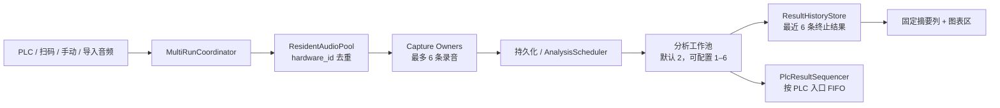

# 多运行常驻音频测试 Core 设计

日期：2026-07-25

状态：已批准

## 1. 文档定位

本文是“常驻音频流、多运行并发测试和多结果显示”改造的总纲规格。
它定义跨子系统不可违背的产品行为、架构边界、数据身份、并发上限、故障语义和验收标准。

后续必须拆分为以下四份子规格，并按顺序规划、实施和审查：

1. 常驻音频采集池、时间戳环形缓冲与六路并发录音；
2. 多 `run_id` 运行协调、分析队列与 PLC FIFO；
3. 结果历史、固定摘要列、锁定模式与可选实时预览；
4. 硬件管理保护、故障恢复和端到端集成验收。

子规格可以补充实现细节，但不得降低或改变本文定义的保证。若子规格发现本文存在冲突或缺口，
必须先修订并重新审查本文，不能在实现中自行选择另一种语义。

本文不是单个实现任务，也不授权一次性重写全部相关模块。

## 2. 背景与当前行为

当前工厂模式面向单运行设计：

- `FactoryModeController` 在 `running`、`analyzing` 和 `reanalyzing` 阶段阻止新的启动；
- PLC 和扫码信号在忙碌阶段会被记录后丢弃，PLC 启动位随后被自动复位，信号不可恢复；
- 控制器只持有一个活动配置、一个活动运行和一个 `FactoryReviewPayload`；
- `TestManager` 的多个运行与完成会话仍有按 `config_id` 索引的路径，同一配置的新运行可能覆盖旧上下文；
- 结果模块和所有图表监听同一个当前结果，界面只能展示一条结果；
- 录音器虽然已经支持同一设备的多个 capture owner，但输入流仍随测试创建和停止；
- 启动路径包含设备枚举、输入格式检查、线程启动、PortAudio 流打开和首块等待；
- 每次 capture 还会额外丢弃约 50 ms 的预热采样；
- 普通 PLC 默认轮询间隔约为 200 ms；
- 当前结果面板是一个可配置且纵向滚动的网格，其中 `result_summary` 仍是网格项目。

因此，前一台设备结束录音并进入计算时，下一台设备的信号不会开始新的测试；即使仅移除控制器的
忙碌判断，单例运行身份、单例结果载荷、按配置索引和 PLC 回写也会产生覆盖或串线。

## 3. 目标

1. 支持任意数量的已保存设备和测试配置。
2. 当前启用配置最多使用六个不同的实际录音硬件，并为它们维持最多六条常驻输入流。
3. 最多同时录制六条运行；录音结束立即释放录音名额。
4. 分析与录音解耦，前一条正在等待分析或分析时仍可开始下一条录音。
5. 同一个测试配置允许在上一条录音或分析尚未结束时再次触发。
6. 每次触发都使用独立 `run_id` 隔离状态、音频、分析、结果、停止、重分析和 PLC 顺序。
7. 以程序接收到 PLC、扫码或手动启动事件的时间作为录音起点，不再因创建流或预热主动丢失起始音频。
8. 将普通 PLC 默认轮询间隔降为 50 ms，并允许现场配置到 20 ms。
9. 分析使用独立工作池，默认并发两条，可配置为一至六条。
10. 结果摘要改为固定独立列，展示活动运行和最近六条终止结果。
11. 提供锁定自动跟随、解锁手动选择、按运行查看图表和可选的单运行实时预览。
12. 一条硬件流、一次保存或一次分析的故障不能污染或覆盖其他运行。
13. 保留现有测试配置、硬件配置、校准数据、数据库记录和录音文件。

## 4. 非目标与已接受限制

- 软件不负责保证隔音箱内不同待测设备之间的声学互不干扰。
- 不支持超过六条同时录音，也不支持超过六个不同实际输入硬件的当前启用组合。
- 不限制已保存的硬件或测试配置总数。
- 不把分析任务计入六条录音名额。
- 不把界面最近六条结果缓存持久化到下次程序启动。
- 不迁移旧结果面板布局，不保留旧 `result_summary` 网格项目。
- 不增加 PLC `run_id`、结果序号或新的结果消费确认字段。
- 软件只保证同一 `plc_id` 的 PLC 结果写入调用按该 PLC 的入口顺序发生，不保证 PLC 已经消费上一条结果。
  在相同结果地址上，后续结果可能覆盖前一条；这是用户明确接受的现场协议限制。
- 不在锁定模式中让活动任务抢占最新完成结果的图表。
- 不同时显示多条活动运行的实时图表。
- 不要求实时预览显示每一个中间帧；显示帧可降频或丢弃，但原始录音和最终分析不得受影响。
- 不引入独立音频采集进程。
- 不进行与本功能无关的 DSP、数据库或界面重构。

## 5. 术语

- **实际硬件**：由硬件管理功能保存，并以稳定 `hardware_id` 标识的输入设备记录。
- **常驻流**：在当前启用配置需要该硬件期间保持打开的 PortAudio 输入流。
- **运行**：一次触发产生的独立测试尝试，无论最后成功、失败、被拒绝或被停止。
- **活动运行**：已接受且处于录音中、等待保存、等待分析或分析中的初始运行。
- **终止结果**：成功、NG、无结果、错误、容量拒绝或手动停止的运行结果。
- **重新分析操作**：依附于一条仍在结果缓存中的终止结果的二次分析；它不创建新运行或新卡片，
  但在硬件与配置维护门禁中仍视为活动操作。
- **配置快照**：触发被接受时冻结的测试配置、硬件解析信息和校准数据。
- **锁定模式**：右侧结果自动跟随最新终止结果，旧结果卡不可选择的显示模式。
- **实时预览**：解锁后选择一张活动卡时，对该运行低优先级、可降频的临时图表显示。

## 6. 方案选择

### 6.1 采用：常驻采集池 + 多运行协调器

采用一个按 `hardware_id` 去重的常驻音频采集池、一套按 `run_id` 管理的运行协调器、
独立分析调度器、结果历史存储和 PLC 结果排序器。

该方案复用现有应用进程、Qt 服务结构和分析能力，同时消除每次启动时重新打开输入流的延迟。

### 6.2 不采用：每个配置预建完整会话

该方案会让引用同一硬件的配置重复占用资源，并使“配置数量不限”与预建资源数量直接冲突。

### 6.3 不采用：独立音频采集进程

独立进程能提供更强故障隔离，但需要额外的 IPC、共享内存、时钟映射和恢复协议，超出当前需求。

## 7. 总体架构

### 7.1 ResidentAudioPool

负责：

- 根据当前启用配置解析稳定 `hardware_id`；
- 同一实际硬件只创建一条输入流；
- 维护流格式、健康状态、时间戳映射和至少 2.0 秒环形缓冲；
- 注册和移除多个并发 capture owner；
- 原子拥有全局六条 capture lease，提供预留、提交、释放和取消；
- 将音频块可靠送入每条活动 capture；
- 发布流可用、失败、恢复和输入溢出事件；
- 在配置选择、维护操作和程序退出时协调流生命周期。

它不负责测试配置判定、结果排序、PLC 写入或界面选择。

### 7.2 MultiRunCoordinator

负责：

- 在事件入口第一时间记录单调时钟时间；
- 路由配置并执行启动前校验；
- 为每次尝试分配唯一 `run_id`；
- 冻结配置与校准快照；
- 管理按 `run_id` 索引的运行状态机；
- 通过 `ResidentAudioPool` 的 capture lease 接口申请录音名额，不维护第二份容量计数；
- 把完成录音交给持久化和分析调度；
- 把终止结果交给结果历史和 PLC 排序器；
- 按 `run_id` 处理停止、迟到事件和重新分析。

它不直接执行 PortAudio 回调、重型 DSP 或图表绘制。

### 7.3 AnalysisScheduler

负责：

- 使用独立工作池执行最终分析和重新分析；
- 默认同时分析两条，允许配置为一至六条；
- 等待队列只保存 `run_id`、文件引用和轻量元数据，不保存完整 NumPy 音频数组；
- 内存中预取的等待任务不得超过当前分析 worker 数；
- 将实时预览工作设置为低于录音保存和最终分析的优先级；
- 通过取消标记抑制已停止运行的迟到结果。

### 7.4 ResultHistoryStore

负责：

- 保存活动卡片状态；
- 保存最近六条终止结果的摘要和 `ResultDisplayPayload`；
- 维护 `selected_run_id` 和 `follow_latest`；
- 在终止结果超过六条时原子淘汰最旧卡片及其显示载荷；
- 为人工判定和重新分析提供明确的目标 `run_id`。

### 7.5 PlcResultSequencer

负责：

- 为每个 PLC 入口分配单调递增的触发顺序；
- 缓存已完成但前序尚未写入的结果；
- 按同一 PLC 的触发顺序调用现有 PLC 结果写入；
- 保证一个结果载荷的字段写入不会与同一 PLC 的另一个结果载荷交错；
- 为每个 PLC 维护已接受 PLC 运行的活动计数，使“测试中”状态不会因其中一条先完成而过早清零。

它不等待 PLC 消费结果，也不提供传输级持久消息保证。

## 8. Core 不变量

以下规则在所有子规格和实现中均为强制要求：

1. **运行身份不变量**：运行时状态、音频、分析、实时帧、结果、人工判定和重新分析均以 `run_id`
   为主身份；`config_id` 不能作为运行唯一键。
2. **时间边界不变量**：捕获起点来自事件入口记录的单调时钟时间，不来自会话构建完成时间。
3. **无隐式延后不变量**：若无法取得触发时刻对应采样，本次运行必须失败，不能从更晚位置静默开始。
4. **回调隔离不变量**：音频回调不得执行分析、数据库、文件保存、PLC 通信或界面工作。
5. **容量不变量**：`ResidentAudioPool` 是六条录音容量的唯一原子裁决者；第七条不排队并明确失败。
   分析等待不占录音名额，协调器不得维护可与 capture lease 分歧的第二份计数。
6. **共享不变量**：同一 `hardware_id` 只有一条常驻流，但可以扇出给多个重叠 capture。
7. **快照不变量**：原始分析和以后对该运行的重新分析均使用触发时冻结的配置与校准快照。
8. **事件归属不变量**：迟到或乱序事件只能更新其携带的 `run_id`，不能覆盖当前所选结果。
9. **PLC 顺序不变量**：同一 PLC 的结果写入尝试顺序等于 PLC 启动入口顺序；非 PLC 来源运行不进入
   PLC FIFO，也不写 PLC 结果。
10. **故障隔离不变量**：一条硬件流故障只影响引用该硬件的运行和配置。
11. **显示不变量**：锁定模式只自动跟随最新终止结果；活动运行不会清空已完成结果图表。
12. **缓存不变量**：终止结果的卡片与其 `ResultDisplayPayload` 一起原子加入和淘汰，界面不得保留
    无卡片的悬空结果或无显示载荷的终止卡。

## 9. 核心数据契约

### 9.1 RunContext

每次触发尝试首先创建最小身份记录，至少保存：

- `run_id`；
- `trigger_source`；
- 单调触发时间和墙钟显示时间；
- 当前尝试状态、错误类别、取消标记和终止原因。

其他字段按解析进度可空：

- `config_id`：目标配置解析成功后填写；无法匹配配置的拒绝尝试允许为空；
- `hardware_id`：配置绑定硬件解析成功后填写；导入音频及解析失败时允许为空；
- `plc_id` 和 `plc_sequence`：所有 PLC 入口在配置解析前填写；非 PLC 来源为空；
- 工单数据：读取到的 SN、型号和转速按字段填写；
- 配置与校准快照：只有被接受的录音运行或导入音频分析必须存在；校验前被拒绝的尝试允许为空；
- 捕获时长、采样率、声道数和捕获边界：capture lease 提交后必须存在，拒绝尝试允许为空；
- 持久化音频引用、分析结果和图表载荷引用：仅在对应阶段成功后存在。

`run_id` 在事件时间记录后立即分配。PLC 来源还必须立即按 `plc_id` 分配 `plc_sequence`，
然后才解析配置和硬件。这样配置无效、硬件不可用和容量拒绝仍可进入同一 PLC FIFO。
被接受运行必须先成功冻结快照，再提交 capture lease；拒绝尝试不得伪造空快照为有效配置。

### 9.2 ResidentStream

每条常驻流至少保存：

- `hardware_id`；
- 已解析的设备名和 Host API；
- 实际采样率和输入声道数；
- 流 generation；
- 单调时钟到绝对采样游标的映射；
- 至少 2.0 秒环形缓冲，容量不得低于 `ceil(actual_sample_rate * 2.0)` 帧；
- 活动 capture owner 集合；
- 健康状态、最后错误和重试状态。

流 generation 用于拒绝旧流关闭后仍到达的回调。

### 9.3 ResultEntry

每个结果条目至少保存：

- `run_id`；
- 可空 `config_id`；配置未匹配的拒绝结果允许为空；
- 配置名称与必要的配置摘要；配置未匹配时显示入口 PLC 或触发来源的可读占位标签；
- SN、触发来源、开始时间和终止时间；
- 当前或最终阶段；
- OK、NG、无结果、失败、容量拒绝或手动停止状态；
- 可见错误原因；
- 可空的完整 `FactoryReviewPayload` 等价载荷；
- 完整结果载荷为空时必须存在结构化错误页载荷，至少包含错误类别、可读原因和可用的入口上下文；
- 是否允许人工判定和重新分析。

每个终止条目必须持有且只持有一种 `ResultDisplayPayload`：

- `ReviewDisplayPayload`：包含完整 `FactoryReviewPayload` 等价载荷和图表数据；
- `ErrorDisplayPayload`：包含结构化错误类别、可读原因和可用入口上下文，不包含图表数据。

成功、NG 和具有完整分析输出的结果使用 `ReviewDisplayPayload`。配置拒绝、容量拒绝、硬件不可用、
保存失败及无法构建完整 review 的结果使用 `ErrorDisplayPayload`。两类载荷使用相同的六条缓存、
选择、原子替换和原子淘汰规则。

### 9.4 事件总线

所有运行期事件必须携带 `run_id`，包括：

- 启动已接受或拒绝；
- 录音进度与录音完成；
- 实时 STFT、SPL、响度、倍频程、FFT 和电流帧；
- 进入等待分析或分析；
- 自动分析成功、无结果或错误；
- 停止、取消和清理完成；
- 重新分析完成；
- 结果选择变化。

允许继续携带 `config_id` 用于路由和标签，但消费方必须首先按 `run_id` 过滤。

## 10. 常驻流生命周期

### 10.1 启动与选择恢复

1. 程序恢复当前启用配置。
2. 解析每个配置绑定的稳定 `hardware_id`。
3. 按 `hardware_id` 去重。
4. 若不同硬件超过六个，工厂模式保持未就绪并显示明确原因。
5. 为不超过六个硬件打开常驻流。
6. 每条流取得首个有效音频块后标记为可用。
7. 引用成功流的配置可以接收启动；引用失败流的配置单独禁用。

不要求所有配置同时可用后才允许无关硬件上的测试。

### 10.2 选择变化

在没有活动运行时：

- 打开新启用配置需要且尚未存在的流；
- 仅当没有任何启用配置引用某硬件时关闭其流；
- 先确认新增流可用，再发布对应配置就绪。

在存在活动运行或重新分析操作时，配置重新绑定和会改变常驻流集合的选择变化必须被禁止。

### 10.3 设备维护

设备刷新、添加、删除、重新绑定和校准需要音频设备独占权：

- 存在录音中、等待保存、等待分析、分析中或重新分析操作时禁止这些操作；
- 全部活动运行结束后，停止受影响常驻流；
- 执行维护操作；
- 重新解析当前选择并重建常驻流；
- 任一步失败都显示明确错误，不把旧流假装为可用。

只读查看和不改变稳定 `hardware_id` 的显示名称修改可以继续进行。

### 10.4 流失败与恢复

- 流打开失败时，仅相关配置不可用；
- 运行中流断开或输入数据不可恢复时，使用该流的所有录音运行终止为失败；
- 其他常驻流、录音和分析继续运行；
- 后台按受控退避自动重连；
- 重连取得有效音频块后恢复相关配置；
- 旧 generation 的回调不得恢复或完成任何新运行。

## 11. 触发与捕获流程

### 11.1 通用触发入口

PLC、扫码和手动入口遵循同一顺序：

1. 立即记录事件单调时间；
2. 分配 `run_id`；
3. PLC 来源立即按 `plc_id` 分配 `plc_sequence`；
4. 解析目标配置、工单和硬件；
5. 校验配置仍启用、硬件流可用；
6. 冻结配置与校准快照；
7. 向 `ResidentAudioPool` 原子申请 capture lease；
8. lease 预留成功后创建活动卡并提交从事件时间开始的 capture；
9. PLC 运行在 capture lease 提交成功后才增加 PLC 活动计数并写“测试中=True”。

不得先完成设备枚举、会话构建或分析管线创建后再记录捕获起点。

capture lease 具有以下唯一状态转换：

- `reserve(run_id)`：原子检查全局已预留及已提交 lease 是否少于六条，并预占一个名额；
- `commit(run_id, capture_owner)`：把预留名额绑定到已经注册成功的 capture；
- `release(run_id)`：capture 正常结束后释放；
- `cancel(run_id)`：注册失败、启动取消或录音中止时释放。

任何路径最多释放一次。协调器可读取 lease 状态用于显示，但不得自行递增或递减容量。

### 11.2 环形缓冲与捕获边界

- 每条流维护至少 2.0 秒的滚动采样和绝对采样游标；
- 时间戳映射使用单调时钟，不使用可跳变的墙钟；
- 注册 capture 时，将事件时间映射到最接近且不早于该时间的采样帧；
- 注册发生在后续回调时，先从环形缓冲补齐事件时间之后的已到达采样，再继续接收未来采样；
- 不把事件时间之前的音频作为可见预录音加入结果；
- 取消现有固定约 50 ms 的 session warmup；
- 起点误差验收上限为一个输入音频块；
- 若调度延迟超过环形缓冲覆盖范围，本次运行失败为“触发音频已移出缓冲”。

不同配置允许不同录音时长。同一流上的每个 capture owner 独立计算结束边界。

### 11.3 容量拒绝

当已有六条录音时：

- `reserve(run_id)` 对第七条返回容量拒绝，该启动不进入等待队列；
- 立即创建“并发容量已满”终止卡；
- 记录结构化日志；
- PLC 触发时生成失败结果和独立容量错误类别；
- 不写“测试中=True”；
- 不改变已有六条运行。

错误类别到 Siemens `Int16` 数值的映射由第二份子规格集中定义，必须为容量、硬件不可用、
缓冲过期和分析失败提供可区分的稳定代码。

### 11.4 其他启动拒绝

配置未匹配、配置失效、硬件未绑定、常驻流不可用和快照校验失败均创建终止错误卡。

- PLC 来源尝试已经具有 `plc_id` 和 `plc_sequence`，因此必须以失败结果进入该 PLC FIFO；
- 即使 `config_id` 无法解析，仍使用入口 `plc_id` 的结果字段写入错误类别；
- 未接受尝试不增加 PLC 活动计数，不写“测试中=True”；
- 扫码和手动来源只创建本地错误卡和日志，不写 PLC；
- 导入音频的文件或配置校验失败同样创建本地错误卡，不占录音名额。

### 11.5 同一配置重复触发

- 同一配置可以同时存在任意多个运行上下文；
- 仍受全局六条录音限制；
- 每条运行捕获独立时间区间，即使它们引用同一常驻流且区间重叠；
- 任何按 `config_id` 保存单个活动或完成会话的结构都必须被替换或降级为查询索引。

## 12. 录音结束、保存和分析

1. capture 达到自身目标采样数后原子结束；
2. 原子冻结该运行的磁盘后备音频 artifact，停止接收后续采样；
3. 冻结完成后立即释放对应 capture lease；
4. 通过非音频回调路径完成录音文件和现有数据库记录；
5. 保存成功后进入等待分析队列；
6. 分析工作池有名额时进入分析；
7. 成功、NG、无结果或异常均形成终止结果；
8. 终止结果同时通知结果历史和 PLC 排序器。

capture 必须在录音期间通过音频回调之外的可靠 drain 写入预分配文件、内存映射文件或等价的
磁盘后备 artifact。每个活动 capture owner 在音频回调与 drain 之间最多保留八个尚未写入的
`CapturedAudioBlock` 引用；第九个块到达前仍无法腾出空间时，该 capture 明确失败为输入持久化
积压，不能阻塞音频回调或扩大队列。录音结束后不得把完整数组留在等待保存或等待分析队列。

文件保存和数据库操作失败时不得继续生成看似有效的最终结果。只有最多
`analysis_worker_count` 条正在分析或已预取任务可以加载完整音频数组，其中
`analysis_worker_count <= 6`。其余等待任务只能持有持久化文件引用和轻量元数据。
测试必须断言排队数量增加时，内存中完整音频数组的数量不超过 `analysis_worker_count`。

## 13. 分析与重新分析

- 自动分析工作池默认并发两条，可配置为一至六条；
- 分析并发上限不改变六条录音上限；
- 分析排队时卡片显示“等待分析”；
- 运行使用自己的配置和校准快照；
- 同一配置的不同运行可以乱序完成；
- 界面按真实完成时间更新；
- PLC 回写由顺序器重新按触发顺序排列；
- 重新分析只允许作用于仍在最近六条缓存内、具有完整可读音频 artifact、有效分析窗口、
  配置快照且 `manual_reanalysis_allowed=True` 的终止结果；
- 容量拒绝、硬件不可用、无完整音频或已经淘汰的结果不允许重新分析；手动停止结果仅在仍具有
  完整可读音频、有效窗口且现有能力标记允许时才可重新分析；
- 重新分析针对明确 `run_id`，在原终止卡上显示“重新分析中”，不创建活动卡或第二张卡，
  不离开六条缓存，也不改变卡片排序；
- 重新分析成功时原子替换原卡的摘要和图表载荷；
- 重新分析失败时原卡变为失败结果并显示重新分析错误页，旧图表载荷被替换，不静默回退旧判定；
- 重新分析开始前必须保留原终止结果载荷直到操作终止；用户点击“停止测试”取消重新分析时，
  原卡恢复重新分析前的结果和图表，不改为“手动停止”、不新增卡片；
- 若重新分析期间该卡成为第七条终止结果到达时的最旧淘汰项，严格执行六条上限：取消重新分析、
  淘汰该卡并忽略迟到结果；
- 人工判定只允许作用于仍在缓存、具有对应持久化测试记录且现有人工判定服务允许修改的终止结果；
  它同样只更新目标 `run_id`；
- 重新分析和人工判定属于本地结果更新，不再次写 PLC，也不创建新的 PLC FIFO 槽。

导入 WAV 分析同样创建独立 `run_id` 和活动卡，使用同一分析工作池并计入最近六条终止结果，
但不占录音名额，也不要求常驻硬件。

## 14. PLC 并发语义

### 14.1 启动检测

- 保留普通 PLC 的 `0 -> 1` 上升沿语义和启动位自动归零；
- 默认轮询间隔由约 200 ms 改为 50 ms；
- 允许现场配置到 20 ms；
- “收到信号的时间”定义为软件轮询检测到上升沿并构造入口事件的时间；
- 本功能不声称恢复 PLC 物理位真实跳变时间。

### 14.2 测试中状态

每个 PLC 维护已接受且尚未终止的 PLC 运行计数：

- 计数从零变为一时写 `ResTestingSignal=True`；
- 某条运行终止时递减；
- 仅在计数变为零时写 `ResTestingSignal=False`；
- 容量拒绝、配置无效和硬件不可用等未接受运行不增加计数；
- 手动、扫码和导入音频运行不改变 PLC 测试中状态。

### 14.3 结果顺序与范围

PLC FIFO 只包含 `trigger_source=plc` 的入口。手动、扫码和导入音频运行即使配置绑定 PLC，
也不进入 PLC FIFO、不写 PLC 测试中状态和结果。

每个 PLC 按入口顺序维护一个 FIFO：

- PLC 入口在配置解析前取得 `plc_sequence`；
- 后触发运行即使先分析完成，也先保存在顺序器；
- 配置未匹配、配置失效、硬件不可用、容量拒绝和其他终止失败都占据其 PLC 入口顺序并形成失败载荷；
- FIFO 头部产生终止载荷后，顺序器对该结果执行且只执行一次 PLC 写入尝试；
- 一次结果的全部字段写入在对应 `PlcService` 线程内串行完成，不能与同一 PLC 的下一结果字段交错；
- 写入尝试成功或失败后都移除该 FIFO 头并继续后序；失败必须记录 `run_id`、`plc_id`、
  `plc_sequence` 和字段原因，但本功能不持久重试该结果；
- 不同 PLC 之间不要求全局顺序；
- 人工判定和重新分析更新已存在结果时不再次写 PLC。

### 14.4 已接受的传输限制

现有协议没有 `run_id`、序号或消费确认。软件写 `ResFinishSignal=True` 后不等待 PLC 清零或确认。
因此，本规格只保证 PC 侧按 `plc_sequence` 发起一次写入尝试，不保证 PLC 已读取每条结果；
即使 `ResFinishSignal` 一直保持 `True`，顺序器也继续处理后续结果，连续结果可能覆盖同一组地址。
本功能不新增握手，也不因该限制禁止同一 PLC 或同一配置并发。

## 15. 结果摘要与图表

### 15.1 固定布局

结果区域拆分为：

- 左侧固定约 360 逻辑像素宽、占满结果区域高度的摘要列；
- 右侧自动占用剩余宽度的现有可配置图表网格和纵向滚动区。

旧 `result_summary` 模块从网格、布局校验和布局编辑器中删除。旧面板布局不迁移，可直接使用新的
默认图表布局。结果卡负责“多页”导航，右侧单个结果内部不增加分页标签。

### 15.2 卡片集合与排序

摘要列是可滚动区域：

- 活动卡位于上部，显示录音中、等待保存、等待分析或分析中；
- 终止卡位于其后，按终止时间倒序；
- 活动卡不占六条终止结果缓存；
- 最近只保留六条终止结果；
- 成功、NG、无结果、错误、容量拒绝和手动停止均计入六条；
- 新终止结果加入时，最旧终止卡及其 `ReviewDisplayPayload` 或 `ErrorDisplayPayload` 一起原子淘汰。

重新分析不把原终止卡移入活动区；原卡保持原排序和缓存位置，仅在卡内显示“重新分析中”覆盖状态。

每张卡至少显示：

- 配置名称；
- SN，没有时显示 `—`；
- 触发来源；
- 开始时间；
- 当前阶段；
- 最终 OK、NG 或可读错误原因。

### 15.3 锁定模式

- 锁图标固定在摘要列右下角；
- 每次程序启动默认为锁定；
- 锁定状态不跨程序重启保存；
- 锁定时旧终止卡不可点击，但摘要列仍可滚动；
- 右侧自动跟随最新终止结果；
- 新活动卡不会清空或替换当前完成结果；
- 最新终止结果为失败时，右侧切换为错误页，不能继续显示旧图表造成误解；
- 重新锁定时立即选择最新终止结果。

当缓存中没有终止结果时：

- 摘要列显示“暂无结果”，锁图标仍显示锁定；
- 右侧图表区显示“等待测试结果”的空状态，不保留上次进程或已经淘汰的图表；
- 新活动卡可以出现，但锁定模式仍保持空状态，直到第一条终止结果到达；
- 没有终止结果时执行重新锁定是幂等操作，仍停留在空状态。

### 15.4 解锁模式

- 用户可以选择缓存中的任意终止卡；
- 新结果仍插入历史，但不改变当前选择；
- 人工判定和重新分析作用于当前选择的 `run_id`；
- 若当前选择恰好是被第七条终止结果淘汰的最旧结果，界面自动切换到最新终止结果并提示
  “所查看结果已移出缓存”。

解锁且没有终止结果时，右侧仍显示空状态；用户选择活动卡后才进入实时预览，取消选择或活动运行
终止并被淘汰后返回空状态或按现有最新终止结果规则选择。

### 15.5 可选实时预览

- 锁定模式不显示活动运行的实时图表；
- 解锁后允许选择一张活动卡作为实时预览目标；
- 图表只接受该 `run_id` 的实时帧；
- 同一时刻只预览一条活动运行；
- 实时 STFT 等显示工作使用低优先级、有界队列和降频策略；
- 负载过高时允许丢弃中间显示帧；
- 不允许丢弃原始录音、改变最终分析输入或阻塞音频回调；
- 运行完成后以完整最终图表替换该运行的实时预览。

## 16. 停止、关闭与迟到事件

### 16.1 停止测试

界面继续使用现有按钮文字“停止测试”，但并发语义改为停止全部：

- 停止所有录音中、等待保存、等待分析、分析中的运行以及重新分析操作；
- 每条初始活动运行生成“已手动停止”终止卡；
- 被取消的重新分析恢复操作开始前的原终止结果和图表，不生成“已手动停止”卡；
- 已接受 PLC 运行正确减少对应 PLC 活动计数；
- 常驻音频流保持打开；
- 停止完成后仍可接收新的启动信号。

若底层分析调用无法立即中断，协调器必须先标记取消。初始运行的迟到结果不得覆盖“已手动停止”；
重新分析的迟到结果不得覆盖已经恢复的原终止结果。

### 16.2 程序退出

程序退出顺序为：

1. 停止接收 PLC、扫码和手动启动；
2. 标记并取消所有活动运行和重新分析操作；
3. 每个 `PlcService` 停止接受新的结果写入，并在自己的单线程写队列中标记 shutdown barrier；
4. barrier 之前已经开始的一个 FIFO 头部结果继续完整写完或明确失败；其字段写入期间不得插入
   `ResTestingSignal=False`；
5. barrier 之后尚未开始的 FIFO 结果在记录 `run_id` 和 `plc_sequence` 后丢弃；
6. 当前结果写入完成或失败后，对存在非零 PLC 活动计数的 `plc_id` 将本地计数归零，并在同一
   `PlcService` 写队列中写 `ResTestingSignal=False`；
7. 退出取消不创建新的结果卡、不进入 PLC 结果 FIFO；
8. 停止实时预览与分析调度；
9. 从设置 shutdown barrier 起最多等待 3 秒完成当前 PLC 载荷、测试中状态写入和其他受控清理；
10. 关闭所有常驻输入流；
11. 释放硬件和线程资源。

退出时写 `ResTestingSignal=False` 是尽力清理：写入失败必须记录 PLC id 和原因，但不能无限阻止
应用退出。若当前 PLC 写调用阻塞到 3 秒上限，关闭该 PLC 客户端并记录“当前载荷可能部分写入、
测试中状态未确认清零”，不得另一个线程并发写 `False`。本功能不新增离线重放该清零请求的
持久协议。

## 17. 错误处理与可观测性

至少区分并记录以下错误类别：

- 并发容量已满；
- 配置未启用或已失效；
- 配置引用硬件超过六个；
- 常驻流打开失败；
- 常驻流运行中断开；
- 输入溢出或不可恢复采样缺口；
- capture 持久化队列超过八块；
- 触发时间已移出环形缓冲；
- 录音保存失败；
- 数据库写入失败；
- 分析或重新分析失败；
- PLC 状态或结果写入失败；
- 用户停止。

日志至少包含 `run_id`、`config_id`、可用的 `hardware_id`、触发来源、阶段和错误类别。
不得仅记录“busy”后静默丢弃启动信号。PLC 写入失败不应回滚已经完成并显示的本地结果，但必须保留
可见日志并遵守现有 PLC 重连策略。

## 18. Compatibility / Migration

- Backward compatibility: partial
- Protected surfaces: [现有测试配置、硬件配置、稳定 `hardware_id`、校准数据、数据库记录、录音文件、普通 PLC 字段偏移与数据类型、PLC 上升沿启动语义、扫码/手动/导入音频入口、现有最终分析算法与结果含义]
- Allowed breakage: [旧结果面板布局、旧 `result_summary` 网格模块、单运行控制器状态与内部事件签名、按 `config_id` 唯一索引运行的内部接口、“停止测试”只停止单条运行的旧语义、工厂模式公共图表无选择地接收任意实时帧的旧行为]
- Migration strategy: other

迁移策略说明：

- 旧结果面板布局不做兼容读取，直接使用新的固定摘要列和默认图表布局；
- 内部事件和服务接口直接升级为 `run_id` 感知契约，不保留单运行兼容层；
- 不主动删除或重置现有测试配置、硬件、校准、数据库记录或录音文件；
- Core 设计本身不要求数据库 schema 破坏性迁移；
- 若子规格确实需要新增数据库字段，必须提供独立、幂等、保留现有数据的迁移设计，且不得把该需求
  隐藏在实现任务中。

兼容回归必须证明：

- 升级前保存的测试配置仍可读取并执行；
- 升级前硬件记录保留相同稳定 `hardware_id`，配置与硬件绑定仍能解析；
- 现有校准数据仍能按原硬件和声道应用；
- 现有数据库测试记录仍可读取，记录到录音文件的关联仍有效；
- 现有录音文件不被移动、覆盖或改名；
- 普通 PLC 字段偏移、数据类型和已保存地址仍按现有协议读取和写入。
- 对同一既有录音、同一配置快照和同一校准数据，升级前后的最终判定 payload 除
  `run_id`、处理时间戳等身份元数据外必须等价；标量和数组浮点值使用
  `rtol=1e-6, atol=1e-8` 比较，离散状态、错误类别和 OK/NG 必须完全相同。

## 19. 子规格边界与实施顺序

### 19.1 子规格一：常驻音频采集

必须定义：

- `ResidentAudioPool`、`ResidentStream` 和 capture owner 接口；
- 时间戳到采样游标映射；
- 两秒环形缓冲与重叠 capture；
- 六条流、全局 capture lease 裁决器以及预留/提交/释放/取消接口；
- 流 generation、故障、重连和关闭；
- 音频回调实时性测试。

该切片完成前，不修改结果 UI。

### 19.2 子规格二：多运行协调与 PLC

必须定义：

- `RunContext` 状态机和事件载荷；
- `FactoryModeController` 与 `TestManager` 的 `run_id` 化；
- capture lease 客户端行为，不能建立第二份容量计数；
- 录音、保存、分析工作池和取消；
- 同一配置重复触发；
- PLC 活动计数、按 PLC 入口排序的结果 FIFO、单次失败后推进和错误码映射；
- 导入音频运行。

### 19.3 子规格三：结果历史与 UI

必须定义：

- `ResultHistoryStore`；
- 固定摘要列和旧摘要模块删除；
- 卡片状态、排序、六条淘汰；
- 锁定/解锁和选择；
- 失败页、人工判定、重新分析；
- 单活动运行实时预览和帧过滤。

### 19.4 子规格四：硬件与端到端集成

必须定义：

- 配置选择与常驻池协调；
- 添加、刷新、删除、重新绑定和校准的独占维护流程；
- 启动、恢复、退出和流重连；
- 真实或可替代设备的延迟与六路压力验收；
- 全功能回归和部署注意事项。

每个子规格必须独立经过规格审查、实施计划、测试驱动实现、规格符合性审查和代码质量审查。

## 20. 测试策略

### 20.1 常驻采集单元测试

- 相同 `hardware_id` 的多个配置只创建一条流；
- 不同硬件最多创建六条流；
- 七个不同启用硬件使选择未就绪；
- 一个、多个和重叠 capture 获得各自正确区间；
- 同一配置多次重叠 capture 不覆盖；
- 事件时间早于 capture 注册时间时能从环形缓冲补齐；
- 事件时间已过期时明确失败；
- capture 时长不同仍独立结束；
- `reserve/commit/release/cancel` 在竞态下最多占用和释放一次，池外不存在第二份容量计数；
- 单个 capture drain 队列最多保留八块，第九块造成该 capture 失败且不阻塞同流其他 capture；
- 取消一个 capture 不影响同流其他 capture；
- 旧 generation 回调被丢弃；
- 流失败只终止相关 capture。

### 20.2 多运行与分析测试

- 前一条分析中仍可接受下一条录音；
- 六条录音并发成功，第七条立即拒绝；
- 录音结束立即释放名额，不等待分析；
- 分析并发配置一至六生效；
- 等待保存状态可见、可停止且阻止设备维护；
- 分析队列积压时，完整音频数组数量不超过 `analysis_worker_count`；
- 分析乱序完成不会串换结果；
- 同一配置的会话按 `run_id` 保留；
- 配置修改不改变既有运行快照；
- 重新分析更新原运行；
- 重新分析不移动原卡，失败替换为错误页，被缓存淘汰时取消并忽略迟到结果；
- 停止重新分析恢复操作前结果，迟到结果不能再次替换；
- 停止测试取消全部运行并抑制迟到结果；
- 导入 WAV 不占录音名额。

### 20.3 PLC 测试

- 50 ms 默认轮询和 20 ms 配置下仍保持上升沿语义；
- 忙碌分析不再导致启动信号丢弃；
- 容量拒绝不写“测试中=True”；
- 同一 PLC 多运行使用活动计数，最后一条终止才清零；
- 同一 PLC 的运行乱序完成后按 PLC 入口顺序调用结果写入；
- 配置无效、硬件不可用和容量拒绝仍占 PLC 入口顺序并写失败；
- 同一 PLC 的结果字段不会交错，不同 PLC 可独立推进；
- 一次写入尝试失败后记录错误、移除 FIFO 头并继续后序；
- `ResFinishSignal` 保持 `True` 且 PLC 不确认时，后续写入尝试仍按入口顺序发生；
- 手动、扫码、导入音频、人工判定和重新分析均不写 PLC 结果；
- PLC 写入失败有日志且不覆盖本地结果状态；
- 程序退出时活动计数归零并尽力写“测试中=False”，最多等待 3 秒且不生成新结果；
- 退出发生在结果字段写入中途时，当前载荷先完整结束或失败，再由同一写队列写
  “测试中=False”，两者字段不交错；
- 模拟 PLC 写调用阻塞超过 3 秒时，客户端被关闭并记录部分写入及未确认清零，不启动并发清零写；
- 测试明确记录“不等待 PLC 消费确认”的已接受限制。

### 20.4 UI 测试

- 摘要列固定宽度和整列高度；
- 旧 `result_summary` 不再存在于网格和编辑器；
- 启动无终止结果时摘要和右侧显示规定空状态，重新锁定保持幂等；
- 活动卡状态转换正确；
- 等待保存卡片状态可见；
- 终止卡按时间倒序，最多六条；
- 第七条原子淘汰最旧卡和对应显示载荷；
- review 结果与无图表错误结果分别使用两种显示载荷，均可被选择并按相同规则原子淘汰；
- 默认锁定、旧卡禁用但可滚动；
- 新活动卡不替换当前完成结果；
- 新终止结果在锁定模式自动显示；
- 解锁模式保持当前选择；
- 重新锁定选择最新终止结果；
- 失败结果显示错误页；
- 被淘汰的当前结果切换并提示；
- 重新分析和人工判定只更新目标卡；
- 重新分析中的终止卡保持原排序和六条缓存位置；
- 实时预览只接收所选活动 `run_id` 的帧；
- 实时帧拥塞不影响最终结果。

### 20.5 端到端与压力测试

- 两台设备依次启动，第一条分析期间第二条能录到完整起始音频；
- 六条不同硬件同时录音；
- 六条运行共享一个实际硬件并获得各自时间窗口；
- 混合同配置、不同配置、PLC、扫码和手动触发；
- 一条流断开时其他五条继续；
- 分析积压时录音无丢帧；
- 重复添加/移除启用配置后无流泄漏；
- 设备维护和校准不会与常驻流双重占用；
- 程序退出后无残留 PortAudio 流或工作线程。

### 20.6 兼容回归

- 升级前测试配置仍可读取并启动；
- 升级前稳定 `hardware_id`、配置绑定和校准关联保持不变；
- 升级前数据库记录仍可读取并定位原录音文件；
- 原录音文件路径、名称和内容不被改写；
- 已保存普通 PLC 字段偏移和类型继续生效；
- 固定既有录音、配置快照和校准数据的最终分析在升级前后满足
  `rtol=1e-6, atol=1e-8`，离散判定完全相同；
- 旧结果面板布局被明确重置，不触发其他数据重置。

## 21. 验收标准

1. 程序不再因为另一运行处于录音、分析或重新分析而静默丢弃有效启动信号；只允许按本文定义的
   容量、配置或硬件错误明确拒绝。
2. 程序接收事件到捕获起点的采样误差不超过一个输入块，并且不存在固定 50 ms 预热丢弃。
3. 最多六条录音可以同时运行；第七条有明确错误卡、日志和 PLC 失败语义。
4. 同一配置可以重复触发，所有状态和结果以 `run_id` 隔离。
5. 录音结束后无需等待分析即可接受新录音。
6. 分析默认并发两条且可配置一至六条；等待队列不保存完整音频数组，内存中完整分析音频数组
   不超过 `analysis_worker_count`。
7. 同一 PLC 的结果写入尝试严格按 PLC 入口顺序，每条只尝试一次；即使 PLC 不消费或不清零也继续
   后序，不保证消费确认的限制已在文档和测试中明确。
8. 一条输入流失败不会停止无关硬件上的运行。
9. 摘要列固定显示活动卡和最近六条结果；锁定、解锁、淘汰和重新分析符合本文规则。
10. 实时预览的数据不会跨 `run_id` 混合；降低实时刷新不会影响录音和最终 STFT。
11. 现有测试配置、硬件配置、稳定硬件绑定、校准数据、数据库记录及其录音文件关联仍可读取和使用；
    录音文件未被移动、覆盖或改名。
12. 同一既有录音与快照的最终分析数值在 `rtol=1e-6, atol=1e-8` 内等价，离散判定完全相同。
13. 四个子规格和各自实施审查全部通过后，才可宣告整个功能完成。
